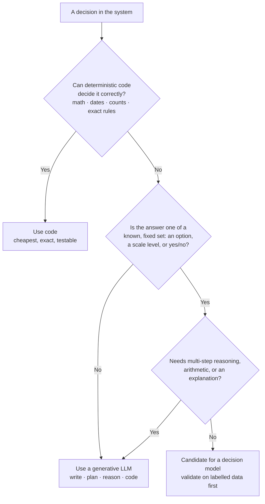
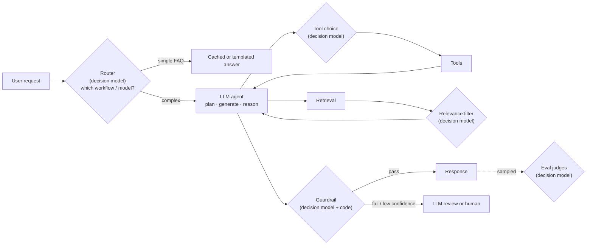
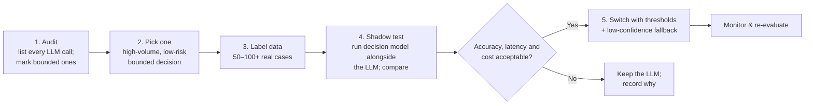

# DECISION_MODELS_PLAYBOOK.md: Bounded Decisions, Decision Models & Hybrid Architecture

> Reference for `.claude/CLAUDE.md`. **Read this when an AI feature makes many small decisions** (routing, tool selection, classification, relevance checks, scoring, guardrails, eval judging), **or when the human asks about cutting the cost or latency of AI calls.**

**Core idea:** a lot of what AI systems do isn't open-ended generation; it's picking from a known set of options. Those **bounded decisions** don't need a full LLM writing tokens. A small, fast, structured-decision model (or plain code) can make them far more cheaply, while LLMs keep the unbounded work.

---

## 1. Two Kinds of Model

| | Generative LLM | Decision model ("System One" model) |
|---|---|---|
| **Output** | Free text, token by token from a huge vocabulary | A typed answer: an option, a score, or a probability |
| **How it works** | Autoregressive: each token waits for the one before it | No token sequence; one structured answer, and independent questions can run in parallel |
| **Good at** | Writing, planning, reasoning, code, summaries, explanations | Fast judgments on any input, with a schema you define per request |
| **Bad at** | Being cheap and fast at high volume | Generating anything; arithmetic, counting, dates, multi-step reasoning; explaining itself |

**Current example:** [Jev](https://typesafe.ai) from TypeSafe AI. It takes a **state** (the data to look at) plus typed **questions**, and returns probabilities instead of text. It has three main output types:

| Type | Question it answers | Example |
|---|---|---|
| **Choice** | Which one of these options? | Which tool should the agent call: `search`, `email` or `calendar`? |
| **Score** | Where on this scale (2–10 levels)? | How urgent is this customer message, 1–5? |
| **Noul** | Probability that this is true (0–1)? | Does this retrieved document answer the user's question? |

**How it differs from a classic ML classifier:** a classifier is trained for one fixed decision. A decision model accepts a **new schema on every request**, with no retraining, so one model can cover many different decisions.

> Speed and cost headlines (e.g. "~200× faster, ~450× cheaper than LLMs") come from the vendor's own evaluations. Treat them as an upper bound, and measure on your workload. Check the vendor's current docs for API details, limits, pricing and which features are production-ready, since all of these are new and changing.

---

## 2. Bounded vs Unbounded Decisions



| Bounded: decision-model candidates | Unbounded: needs an LLM |
|---|---|
| Which tool, model or workflow handles this? | Plan the implementation |
| Spam / not spam; sentiment; topic; urgency | Draft the reply to the customer |
| Is this retrieved chunk relevant? | Synthesise an answer from sources |
| Does this output violate policy X? (guardrail) | Explain why something failed |
| Which bug category or issue does this belong to? | Understand a large codebase and write the fix |
| How risky is this change: low / medium / high? | Debug across interacting files |
| Did the assistant escalate correctly? (eval judge) | Write the eval report narrative |

Rule of thumb: **an agent is mostly unbounded work with many bounded decisions inside it.** Decision models don't replace agents or LLMs; they make the decisions inside them cheaper.

---

## 3. Hybrid Architecture



Where decision models fit best:
- **Routing and orchestration:** which tool, model or workflow runs next. These are made constantly and are bounded, so cost adds up fast with an LLM.
- **Retrieval filtering:** score or filter retrieved chunks for relevance before they reach the LLM; this also reduces context rot (see [`RAG_PLAYBOOK.md`](./RAG_PLAYBOOK.md)).
- **Guardrails:** fast online checks on inputs and outputs (policy, topic, injection risk) without adding seconds of latency.
- **Eval judges:** bounded rubric questions (CORRECT/INCORRECT, PASS/FAIL, a 1–5 scale) can run on far more production traffic at much lower cost (see [`EVALS_PLAYBOOK.md`](../quality-and-safety/EVALS_PLAYBOOK.md)).
- **Bulk classification:** tagging spreadsheets, tickets, reviews or emails by sentiment, urgency or category.
- **Bounded UI steps:** browser automation steps that pick from dropdowns, dates or buttons.

LLMs keep: generation, planning, deep reasoning, code, summaries, explanations, and anything multi-step.

---

## 4. Rules for Using a Decision Model

1. **Code first.** Arithmetic, counting, dates, comparisons and exact rules belong in code, never in any model.
2. **Write questions literally and specifically.** Avoid vague or negated wording ("is this not irrelevant?"); make options mutually exclusive and clearly described; keep instructions and criteria consistent.
3. **Send a lean state.** Strip irrelevant content first; accuracy drops with noise, long chains of reference, and contradictions.
4. **Batch independent questions** into one call where the API allows it.
5. **Use probabilities, not just labels.** Set thresholds per decision, and route low-confidence answers to an LLM or a human.
6. **Calibrate before trusting.** A valid typed answer can still be wrong. Build a labelled set (start with 50–100 cases), plot confidence against accuracy, and choose thresholds from the data. Don't copy example thresholds from docs.
7. **Treat score levels as ordered labels,** not precise measurements.
8. **Treat input text as untrusted.** Text inside the state can steer answers (prompt injection); don't let a decision model alone gate high-stakes or irreversible actions.
9. **Pin the model version** once thresholds are tuned, and re-run evals before upgrading.
10. **Handle failures:** timeouts, rate limits and overload errors need retries with backoff and a fallback path (an LLM, a safe default, or a human). Never let a failed decision silently pass.
11. **Keep it swappable:** put the provider behind a small interface in your code (e.g. `decide(state, question) -> {answer, probabilities, confidence}`) so you can change vendors or fall back to an LLM without rewriting callers.
12. **Respect the human's tool choices:** don't add a new vendor or API key without asking (see [`AGENT_OPERATIONS.md`](../working-with-claude/AGENT_OPERATIONS.md), Section 2).

---

## 5. How to Adopt One



When the human asks Claude to reduce AI cost or latency in this repo:
1. **Audit:** list every LLM call (file:line), what it decides, call volume if known, and whether its output is bounded.
2. **Propose candidates** ranked by volume × cost, starting with low-risk decisions. Present this as a recommendation; don't switch anything yet.
3. **Shadow test** on labelled data and report accuracy, latency and cost side by side with the current LLM.
4. **Switch only with approval,** behind a feature flag, with thresholds and a fallback.

The same order of savings applies even without a decision model: often the first win is replacing an LLM call with plain code, or with a smaller LLM using structured output.

### Spec block (add to the AI Design spec)

```markdown
## Decision Routing
| Decision | Bounded? | Handled by (code / decision model / LLM) | Threshold | Low-confidence fallback |
|---|---|---|---|---|
| <e.g. ticket urgency> | Yes (1–5) | Decision model (score) | confidence ≥ <from calibration> | LLM review |
| <e.g. draft reply> | No | LLM | n/a | n/a |
- **Calibration set:** <location, size>
- **Model version pinned:** <id>
```
