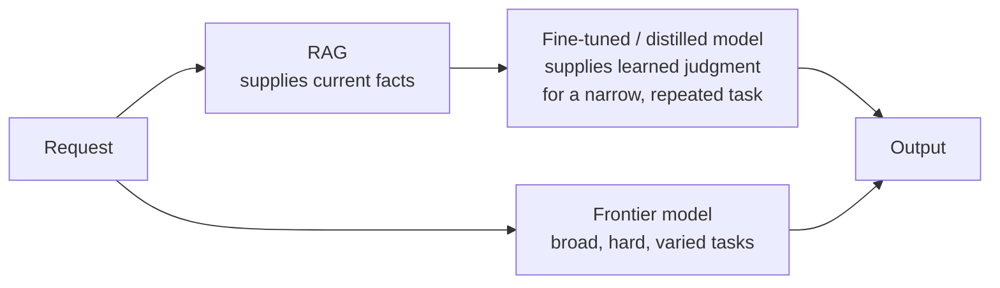
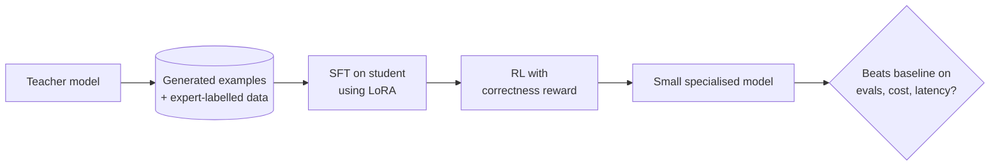
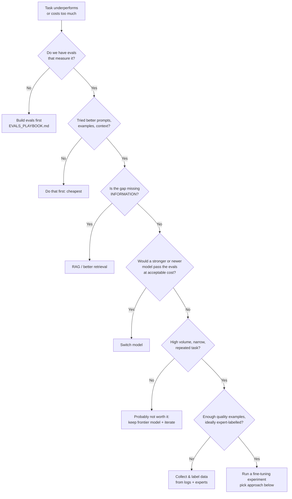

# FINE_TUNING_PLAYBOOK.md: When (and How) to Customise a Model

> Reference for `.claude/CLAUDE.md`. **Read this when evals show a model keeps failing a task despite good prompts and context, when someone proposes fine-tuning, distillation, LoRA or RL, or when high-volume AI calls are too slow or expensive.**

**Bottom line:** fine-tuning isn't dead, but it's rarely the first move. The valuable skill is **judgment**: knowing when training is needed, which kind fits, and proving it helped. Platforms make the infrastructure easier; they can't supply the data, the evals or the decision.

---

## 1. How RAG, Prompting and Fine-Tuning Fit Together

They solve different problems and are often combined:

| Problem | Fix | Why |
|---|---|---|
| Model doesn't understand the instructions or format | **Prompt / context engineering** | Cheapest; try first |
| Model lacks **information** (your docs, policies, fresh data) | **RAG** or long context | Gives it knowledge without retraining ([`RAG_PLAYBOOK.md`](./RAG_PLAYBOOK.md)) |
| Model has the information but **can't perform the task** the way your experts do (judgment, domain patterns, consistent criteria) | **Fine-tuning** | Teaches behaviour, not facts |
| Task works but is **too slow or costly at high volume** | **Distillation** into a smaller model, or a decision model | Cheaper per call ([`DECISION_MODELS_PLAYBOOK.md`](./DECISION_MODELS_PLAYBOOK.md)) |

**Giving a model information isn't the same as teaching it a skill.** An insurance assistant answering policy questions needs RAG. A system judging ambiguous claims like an experienced underwriter may need training on expert decisions, and usually RAG as well.



The common enterprise pattern is **hybrid**: frontier models for broad and difficult work, small specialised models for narrow, repetitive, high-volume tasks, **where the advantage is measured and significant**.

---

## 2. The Types of Fine-Tuning

### Training approaches: *what signal teaches the model*

| Approach | Training data | Example (insurance claims) |
|---|---|---|
| **SFT** (supervised fine-tuning) | Input → desired output pairs | Past claims + experienced underwriters' decisions |
| **Preference optimisation** (e.g. DPO) | Which of two responses is better | Two correct decisions; one explains it better or follows guidelines more closely |
| **RL** (reinforcement learning) | Model acts; receives a reward | Reward from a programmatic correctness check or a reward model trained on human preferences |

### Which parameters change: *how much of the model is updated*

| Method | What it does | Trade-off |
|---|---|---|
| **Full fine-tuning** | Updates all weights | Most flexible; very expensive at billions of parameters |
| **PEFT / LoRA** | Freezes original weights; trains a small set of added parameters | Much less memory and compute; the usual choice |

### Distillation: *teacher → student*
A capable **teacher** model generates examples or signals to train a smaller **student**. The student won't match the teacher everywhere, but it can match or beat it on one specific task, much more cheaply.

These combine: e.g. a teacher generates examples → **SFT** trains a student → **LoRA** keeps training cheap → **RL** sharpens it against a correctness reward.



---

## 3. The Three "Fine-Tuning Is Dead" Arguments

| Argument | When it holds | When it doesn't |
|---|---|---|
| **1. RAG and long context make it unnecessary** | The missing piece is *information*, or the base model is already good enough | The model consistently fails at the *task itself*: expert judgment learned over years |
| **2. Foundation models improve anyway; just wait** | The next model will likely close the gap soon, and the gap isn't costly now | A custom model is measurably better or much cheaper **today**, and that advantage lasts long enough to pay off |
| **3. Too expensive to maintain** | Low volume; no labelled data; no team to run evals and redeploy | High volume; managed training platforms remove the infrastructure burden; owning the model or data matters |

**Reported examples** (company- or vendor-published, on specific tasks; not proof that custom models beat frontier models in general):
- **Bridgewater × Thinking Machines (2026):** on six financial information-filtering tasks, frontier models reached ~50% accuracy with basic prompting and ~75% with better prompts, context and expert guidance. An open-weight model trained with RL and distillation on expert-shaped examples reached ~84.7%, versus ~78% for the best frontier model tested, at ~13.8× lower inference cost per task.
- **XY.AI (2026):** extracting fields from insurance documents. Moving from self-managed training infrastructure to a managed platform went from ~1–2 experiments a week to several a day, cut infrastructure costs 2–3×, and raised accuracy from ~77% to ~87%. **The bottleneck was experiment infrastructure, not the training technique.**

**Beyond cost:** some organisations fine-tune to **own** their expert feedback, data and models, or to run models inside environments they control (data residency, update control). That's a legitimate driver, but it still needs evals to justify it.

> The fine-tuning provider landscape is changing (e.g. the video reports one major provider winding down self-service fine-tuning in 2026 while others expand). **Check current availability, pricing and data policies before choosing a platform.**

---

## 4. Decision Flow: Should We Fine-Tune?



### Picking the approach

| Situation | Start with |
|---|---|
| You have good input → output examples | **SFT with LoRA** |
| Outputs are acceptable but quality/style preferences matter | **Preference optimisation** |
| Correctness can be checked programmatically (right category, valid extraction, tests pass) | **RL** with that check as the reward |
| A big model already does it well; you need it cheaper or faster | **Distillation** into a small model |
| Unsure | Start with **SFT + LoRA** on a small set; measure; add RL or distillation only if evals justify it |

### Rough economics
Fine-tuning pays off when **(per-call savings × call volume) + value of the accuracy gain** exceeds **data labelling + training + evaluation + serving + ongoing maintenance**, over the time the advantage lasts. A few thousand calls a month rarely justifies it; millions of repetitive calls might.

---

## 5. Rules for Claude

1. **Never propose fine-tuning first.** Show that evals exist and that prompts, context, retrieval and model choice were tried, with numbers.
2. **Diagnose the gap:** information (→ RAG) vs task skill (→ maybe training) vs cost (→ distillation or decision model). State which, with evidence from eval failures.
3. **Data is the real bottleneck.** Ask the human about the source and quality of training examples; expert-labelled data matters most. Don't fabricate labels or "correct" outputs.
4. **Keep held-out data separate:** training, validation and test sets never overlap; the eval set used to compare models is never trained on.
5. **Compare against a strong baseline:** the best frontier model with the best prompt and context, on the same evals, plus cost and latency.
6. **Check for regressions:** make sure the tuned model hasn't got worse on other important cases (safety, refusals, formatting, edge cases).
7. **Plan the lifecycle before training:** where it's served, who retrains it, the trigger for retraining, and what happens when a new base model arrives (re-run evals; switch if it now wins).
8. **Privacy and licensing:** confirm training data may be used for training (customer data, PII, contracts), check the platform's data-retention terms, and check the base model's licence.
9. **Approval required:** fine-tuning spends money, sends data to a provider and adds infrastructure. It's a Consult-level decision ([`AGENT_OPERATIONS.md`](../working-with-claude/AGENT_OPERATIONS.md), Section 5).
10. **Keep the model swappable:** model ID in config; calls behind an interface; a fallback to the frontier model.

### Fine-tuning spec block

```markdown
## Model Customisation
- **Problem & evidence:** <eval results showing the gap; what was already tried>
- **Gap type:** information / task skill / cost-latency
- **Baseline:** <best frontier model + prompt + context: accuracy, cost/call, latency>
- **Approach:** <SFT / preference / RL / distillation; LoRA or full> and why
- **Data:** <source, size, who labelled it, train/val/test split, PII handling, licence>
- **Success criteria:** <accuracy ≥ X on held-out set; cost/call ≤ Y; no regressions on Z>
- **Platform & serving:** <managed provider / self-hosted; export possible?>
- **Economics:** <volume × savings vs total cost; break-even>
- **Lifecycle:** <owner; retraining trigger; re-evaluation when new base models ship>
```
