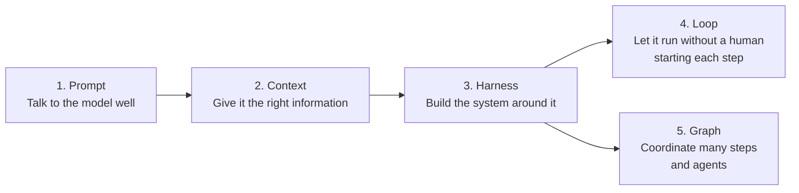
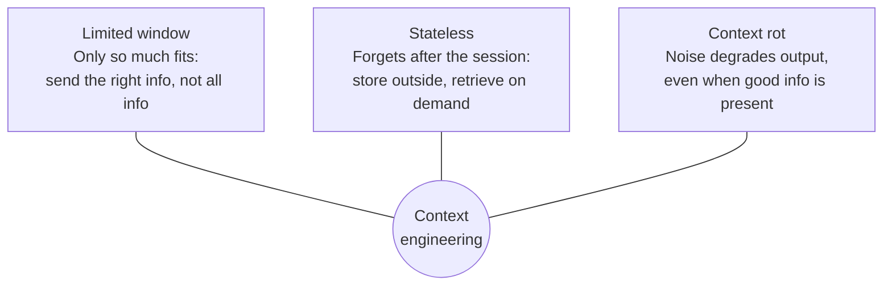
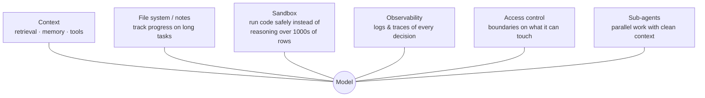
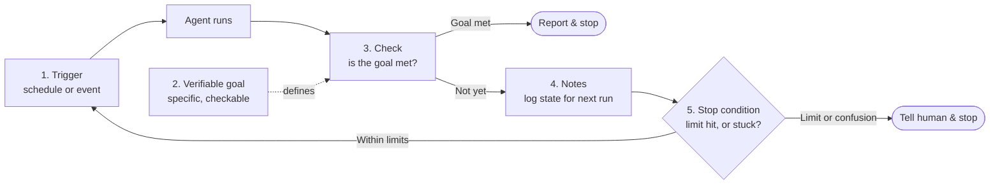
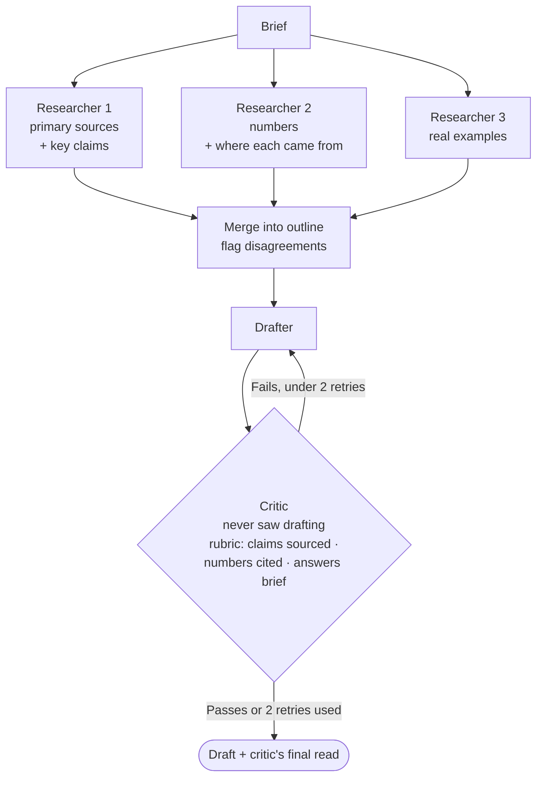

# AI_ENGINEERING_LAYERS.md — Prompt, Context, Harness, Loop, Graph

> Companion to [`AI_SYSTEM_DESIGN.md`](./AI_SYSTEM_DESIGN.md). **Read this when designing or changing an agent, an agentic workflow, a long-running or recurring task, or anything with multiple agents/sub-agents.** It is also how you (the coding agent) should structure your own multi-step work.

The five "shifts" in AI engineering are not separate fads. Each was born from the limits of the one before, and each is a **layer** you still use today:



| Layer | Problem it solved | What it controls | Car analogy |
|---|---|---|---|
| **Prompt** | Answers depended on phrasing | How you ask | The engine |
| **Context** | Model doesn't know your data; limited window; forgets; noise confuses it | What the model sees | Wheels, transmission, frame |
| **Harness** | Real tasks need files, code execution, safety, tracing, sub-agents | Everything around the model | Dashboard, steering, seat belts, mirrors |
| **Loop** | A human had to trigger and check every run | When it runs, and when it stops | Self-driving |
| **Graph** | Many agents and steps getting in each other's way | How work is split and ordered | Road system: lanes, lights, right of way |

**Agent = model + harness.** Context engineering didn't go away; it became part of the harness. Loops and graphs are ways of using the harness well.

---

## 1. Prompt Layer

Modern models handle step-by-step reasoning and tool choice without tricks, so heavy prompt engineering is rarely needed. What still matters:
- **Be clear and specific:** goal, audience, format, constraints.
- **Show, don't describe** formats: two or three real examples beat a paragraph of description.
- **Keep prompts in version-controlled files** and evaluate changes (see [`AI_SYSTEM_DESIGN.md`](./AI_SYSTEM_DESIGN.md), Section 3). Don't rely on "magic phrases".

---

## 2. Context Layer

Three limits drive every context decision:



Rules:
- **Curate, don't dump.** Send the smallest set of relevant, current information. More context is not better context.
- **Strip noise:** irrelevant history, duplicated documents, stale tool output, boilerplate.
- **Persist what must survive** a session (state, decisions, progress) in files or a database, and reload it explicitly.
- Retrieval details live in [`RAG_PLAYBOOK.md`](../ai-building-blocks/RAG_PLAYBOOK.md); memory design in [`AI_SYSTEM_DESIGN.md`](./AI_SYSTEM_DESIGN.md), Section 2.

---

## 3. Harness Layer

The harness is the operating system the agent works inside. For a step-by-step build (context → actions → boundaries → persistence), see [`HARNESS_ENGINEERING_PLAYBOOK.md`](./HARNESS_ENGINEERING_PLAYBOOK.md). A production-worthy harness provides:



Rules when building an agent:
- **Externalise progress:** long multi-step tasks write a progress/notes file so they can resume and don't lose track halfway.
- **Compute with code:** for data-heavy work (reconciling spreadsheets, aggregations, parsing), have the agent write and run a script in a sandbox rather than reasoning over raw data in context.
- **Sandbox execution:** no network or filesystem access beyond what the task needs; time and resource limits; never run model-generated code against production.
- **Trace everything:** inputs, tool calls, outputs, decisions and costs, so any result can be audited.
- **Hard boundaries:** least-privilege access ([`AGENT_OPERATIONS.md`](../working-with-claude/AGENT_OPERATIONS.md), Section 2); high-stakes documents and environments are read-only or off-limits.
- **Sub-agents only when they earn it** ([`AI_SYSTEM_DESIGN.md`](./AI_SYSTEM_DESIGN.md), Section 4).

---

## 4. Loop Layer

A loop removes the human from starting each run. Every loop needs **five parts**. If any is missing, don't build it.



1. **Trigger:** a schedule (every 2 hours, 6 a.m. daily) or an event (file lands in a folder, webhook fires).
2. **Verifiable goal:** specific and objectively checkable ("price < $200", "all tests pass", "inbox has zero untriaged tickets"), never vague ("prices look good").
3. **Check / eval:** how the agent confirms the goal, ideally an objective comparison or an independent checker.
4. **Notes between runs:** a log file or DB (e.g. `price_log.md`) so each run knows what happened before.
5. **Stop condition with limits:** stop when the goal is met; stop **and tell the human** when something unexpected happens (page layout changed, data missing, repeated errors) rather than guessing; and a hard cap (max runs, expiry date, token/cost budget).

### Loop prompt template

```markdown
Every <interval / on <event>>:
- Do: <the task>
- Record: append <what> to <notes file> with date and time.
- Goal check: if <specific, objective condition>, then <notify how> and stop.
- Otherwise: log it silently.
- If <unexpected situation: can't find data, format changed, errors>, tell me and stop. Don't guess.
- Limits: expire after <N days / N runs>; budget <tokens/cost>.
```

Rules:
- **Loops eat tokens.** Use the longest interval that still meets the need, and prefer cheap deterministic checks (a script, an API call) over model calls where possible.
- A loop that acts on the world is an automation: it needs an owner, tripwires and a hard floor ([`AUTOMATION_PLAYBOOK.md`](./AUTOMATION_PLAYBOOK.md)), and it starts at Consult or Augment, not Automate.
- Prefer durable scheduling (CI schedules, cron on a server, the agent platform's scheduled tasks) for anything that must keep running; session-only loops disappear when the session ends.

---

## 5. Graph Layer

When work has many steps or many agents, design it as a **graph**: each **node** is a piece of work with its own instructions; each **edge** says what must happen before what. This lets you parallelise, give each step clean context, and add independent checks.

### Example: research → draft → independent critique



Graph design rules:
- **One clear job per node,** with a defined input and output contract.
- **Parallelise independent nodes** (the three researchers); join them with an explicit merge step that **flags disagreements** instead of hiding them.
- **Clean context per node:** sub-agents start fresh with only what their node needs. This reduces context rot.
- **Independent checkers:** a critic or verifier that has *not* seen the work being produced, judging against an explicit rubric.
- **Bounded revision loops:** every back-edge (critic → drafter) has a max retry count, and the final output includes the checker's verdict.
- **Shared resources need coordination:** nodes that write to the same system need ordering, locks or a single owner node (see [`AUTOMATION_PLAYBOOK.md`](./AUTOMATION_PLAYBOOK.md), Section 4).
- **Start in plain language:** a simple graph can be described to the agent in a prompt. Move to a workflow framework only when the graph needs persistence, retries or monitoring beyond what the harness gives.

### Graph spec template

```markdown
## Graph: <workflow name>
| Node | Job | Inputs | Output | Runs after | Parallel with |
|---|---|---|---|---|---|
| <name> | <one job> | <what it receives> | <what it returns> | <nodes> | <nodes> |

- **Merge rules:** <how outputs combine; how disagreements are flagged>
- **Checker:** <rubric; must be independent of the node it checks>
- **Retry limits:** <max loops per back-edge>
- **Final output:** <what the human receives, including the checker's verdict>
```

### For your own work as the coding agent
For large tasks, apply the same pattern: run independent searches or investigations in parallel with clean context, merge the findings, and have the result checked against the spec by a reviewer that didn't produce it (for high-stakes changes). Keep a progress file for long tasks.

---

## 6. Evaluating the Next Trend

New terms will keep appearing. Before adopting one, answer two questions:
1. **What problem did it come from?** Which limit of the existing layers does it address?
2. **What does it control that the last layer didn't?**

If it controls nothing new, it's an optimisation within an existing layer: adopt it only if evals show it helps. If it solves a genuinely new scaling problem, it may be a new layer worth learning.
