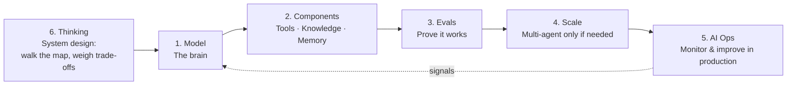
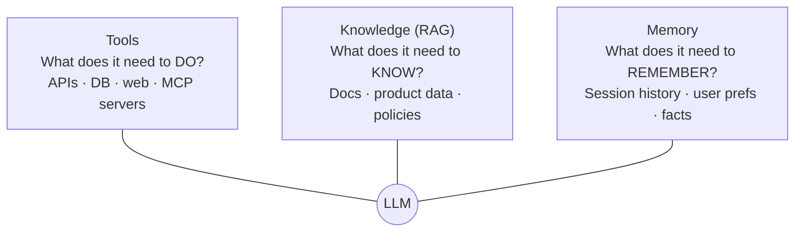
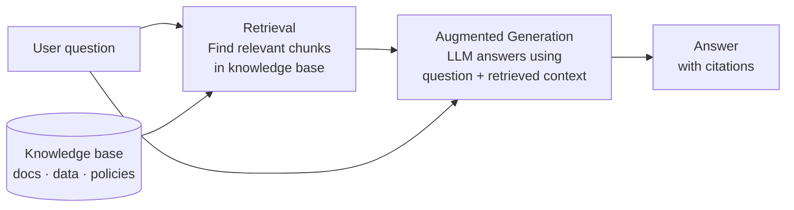
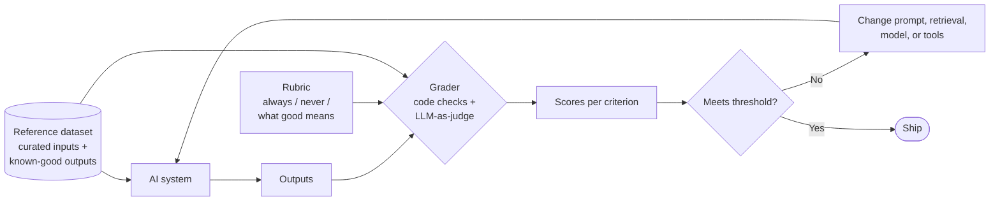
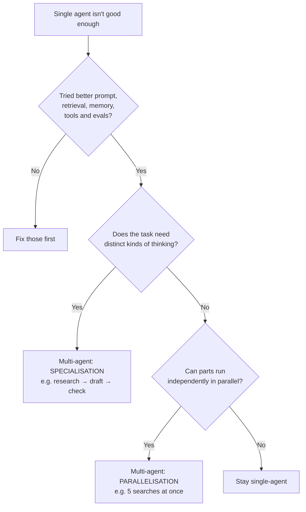
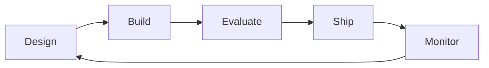

# AI_SYSTEM_DESIGN.md — Building LLM-Powered Features

> Companion to [`WORKFLOW.md`](../working-with-claude/WORKFLOW.md). **Read this whenever a task involves an LLM or AI feature**: chatbots, agents, RAG, summarisation, classification, extraction, AI-generated content, or anything that calls a model API.
> The normal workflow in [`WORKFLOW.md`](../working-with-claude/WORKFLOW.md) (spec → build → review → test) still applies; this file adds what is different about AI systems.

Walk this map for every AI feature. At each node, pick only what the problem needs and state the trade-offs.



---

## 0. The Core Difference: LLMs Are Non-Deterministic

Normal functions are deterministic: `add(2, 3)` always returns `5`. LLMs are not. Phrasing, context and instructions all change the output, and the same input can give different answers.

Design every AI feature assuming the model **will sometimes be wrong, vague or inconsistent**:
- Validate model output before using it (schemas, types, allowed values). Prefer structured output (JSON schema / tool calls) over parsing free text.
- Never let raw model output directly trigger irreversible actions (payments, deletions, sending messages) without a check or human approval.
- Handle failures explicitly: API errors, timeouts, rate limits, refusals, empty or malformed responses, and context-length overflow.
- Keep prompts in version-controlled files, not scattered string literals, so changes can be reviewed and evaluated.

---

## 1. Model Selection

Choosing the model is the most important decision: it sets capability, cost and latency. Models differ in what they're tuned for (code, reasoning, long documents, images/audio) and in size (small, fast and cheap vs large, slow and capable).

Before building, state in the spec:
- **Task type:** classification, extraction, generation, reasoning, code, multimodal?
- **Quality bar:** how bad is a wrong answer?
- **Latency budget:** user-facing (seconds) or background (minutes)?
- **Cost budget:** expected calls per day × tokens per call.
- **Context size:** how much input per call?

Rules:
- Start with the **smallest model that passes the evals**; move up only when evals show it's needed.
- Make the model name a **config value**, not hard-coded, so it can be swapped and compared.
- Check the provider's current docs for model names, limits and pricing rather than relying on memory; these change often.
- **Not every decision needs a generative LLM.** Bounded decisions (routing, classification, relevance, guardrails, eval scoring) can go to code or a structured decision model. See [`DECISION_MODELS_PLAYBOOK.md`](../ai-building-blocks/DECISION_MODELS_PLAYBOOK.md).
- **Fine-tune only when evals prove it's needed** (the model lacks task skill rather than information, or high-volume cost demands a smaller model). See [`FINE_TUNING_PLAYBOOK.md`](../ai-building-blocks/FINE_TUNING_PLAYBOOK.md).

---

## 2. Components: Tools, Knowledge, Memory

An LLM alone can only read a prompt and generate text. What turns it into a useful system is what you wrap around it. For every AI feature, answer three questions in the spec:



### Tools
- Tools let the model call functions to read from or act on external systems. Prefer the **Model Context Protocol (MCP)** or the provider's standard tool-calling format over custom parsing.
- Give each tool a clear name, a precise description and a strict input schema.
- Apply least privilege (see [`AGENT_OPERATIONS.md`](../working-with-claude/AGENT_OPERATIONS.md), Section 2): read-only by default; write/send tools require confirmation or a separate approval step.
- Validate tool arguments before executing; treat model-chosen arguments as untrusted input.
- For how MCP works, what changed in 2026, and rules for using or building servers, see [`MCP_PLAYBOOK.md`](../ai-building-blocks/MCP_PLAYBOOK.md).
- For access control, prompt-injection defence, egress and action controls, see [`AI_SECURITY_PLAYBOOK.md`](../quality-and-safety/AI_SECURITY_PLAYBOOK.md).

### Knowledge (RAG)
> For the full retrieval playbook (method selection, agentic retrieval, citations, access control, freshness), see [`RAG_PLAYBOOK.md`](../ai-building-blocks/RAG_PLAYBOOK.md).

Anything the model wasn't trained on (your docs, product data, policies) is invisible to it. Retrieval-Augmented Generation fixes this like an open-book exam.



Every RAG improvement is an improvement to one of the two halves:
- **Retrieval:** chunking strategy, embeddings, hybrid search (keyword + vector), metadata filters, reranking, freshness of the index.
- **Generation:** instructing the model to answer **only** from retrieved context, cite sources, and say "I don't know" when the context doesn't cover the question.

Rules:
- Ground answers on facts that matter (prices, policies, legal terms, account data) in retrieved sources, never in the model's memory.
- Return source references with answers so they can be checked.
- Evaluate retrieval and generation separately (Section 3).

### Memory
LLMs have no memory between calls. Design it explicitly:
- **Short-term:** conversation history within a session. Decide how to trim or summarise when it exceeds the context window.
- **Long-term:** persists across sessions, stored in a database and retrieved on demand.
  - **Semantic:** facts and preferences about the user.
  - **Episodic:** specific past events or interactions.
- Decide what is stored, for how long, who can see it, and how a user can delete it. Never store secrets; treat personal data under the project's privacy rules.

---

## 3. Evals: Prove It Works

> For the full step-by-step method (error analysis, rubric template, judge calibration, production loop), see [`EVALS_PLAYBOOK.md`](../quality-and-safety/EVALS_PLAYBOOK.md).

Normal tests check one exact expected output. That doesn't work for LLMs: there are many right answers (and many wrong ones). **Evals** define what "good" looks like and measure it systematically. This is the step most teams skip, and it costs the most later.

> **Example:** in 2024 an airline's support chatbot invented a refund policy, a court held the airline to it, and the chatbot was removed. A check that every policy answer matched the real policy text would have caught it.



### How to build evals
1. **Reference dataset:** 20–50 realistic inputs to start, including edge cases and adversarial ones, with known-good outputs or expected facts. Store in `evals/datasets/`.
2. **Rubric:** a short list of criteria, written for this feature:
   - What must it **always** do? (e.g. cite a source, stay under 150 words, use the user's language)
   - What must it **never** do? (e.g. invent a policy, reveal internal data, give legal/medical advice)
   - What does "good" mean? (e.g. answers the actual question, correct facts, right tone)
3. **Graders,** cheapest first:
   - **Code checks** for anything deterministic: valid JSON, required fields, length, banned words, citation present, numbers match source.
   - **LLM-as-judge** for nuanced criteria: give a judge model the rubric, the output, and the reference; ask for a score and a reason per criterion. Spot-check the judge against human ratings.
4. **Threshold:** define the pass rate required to ship, in the spec's Definition of Done.

Rules:
- **No AI feature is done without evals.** Add them to the Definition of Done in [`WORKFLOW.md`](../working-with-claude/WORKFLOW.md).
- Re-run evals on every change to prompts, models, retrieval or tools; a better answer in one place often breaks another.
- Add every production failure to the reference dataset so it can't recur silently.

---

## 4. Scaling Up: Single Agent vs Multi-Agent

> For harness design, loops (trigger, goal, check, notes, stop condition) and graph workflows, see [`AI_ENGINEERING_LAYERS.md`](./AI_ENGINEERING_LAYERS.md).

More agents means more complexity, more failure points and more to debug. **Default to a single agent.**



If you do go multi-agent:
- Give each agent one clear job, its own tools, and a defined input/output contract.
- Have one orchestrator own the final answer.
- Log every agent's inputs and outputs so failures can be traced.
- Eval each agent and the whole system.

---

## 5. Life After Launch: AI Ops

The lab is not production. Real users bring inputs you didn't plan for (in one drive-thru voice AI rollout: accents, traffic noise, several people ordering at once). AI features are built once and improved continuously.



Build these in from the start:
- **Logging/tracing:** prompt version, model, inputs, retrieved context, tool calls, outputs, latency, token cost (with personal data redacted per privacy rules).
- **Monitoring:** error rates, refusals, latency, cost per request, eval scores on sampled live traffic.
- **User feedback:** a way to flag bad answers (thumbs down, report), routed into the eval dataset.
- **Safe rollout:** feature flags, gradual rollout, and a quick way to fall back to a previous prompt/model or turn the feature off.
- **Guardrails** in the request path for high-risk outputs (e.g. block an answer about a policy if it isn't grounded in a retrieved source).

---

## 6. Thinking: System Design for AI Features

System design is taking a real problem and walking the map, choosing what fits and stating the trade-offs. For the full step-by-step process (scope & assumptions → Know/Act/Remember/Coordinate → observability → production → optimization) and a design-doc template, see [`AI_SYSTEM_DESIGN_PROCESS.md`](./AI_SYSTEM_DESIGN_PROCESS.md).

For smaller AI features, extend the six-field spec in [`WORKFLOW.md`](../working-with-claude/WORKFLOW.md) with this section:

```markdown
## AI Design (add to the feature spec)
- **Model:** <which and why; latency, cost, quality trade-off>
- **Tools:** <what it must DO; permissions for each>
- **Knowledge:** <what it must KNOW; sources, RAG approach, freshness>
- **Memory:** <what it must REMEMBER; short/long-term, retention, deletion>
- **Failure modes:** <hallucination, wrong tool call, bad retrieval, prompt injection, cost spike>
- **Evals:** <dataset location, rubric (always/never/good), graders, pass threshold>
- **Architecture:** <single agent, or multi-agent and why>
- **Ops:** <what's logged, monitored, how users flag issues, rollback plan>
```

Present the AI Design section to the human for confirmation before building, as with any spec.
