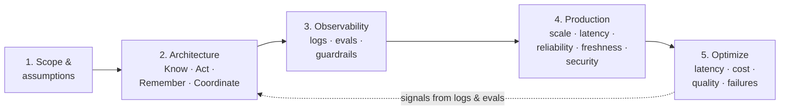
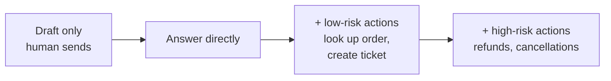
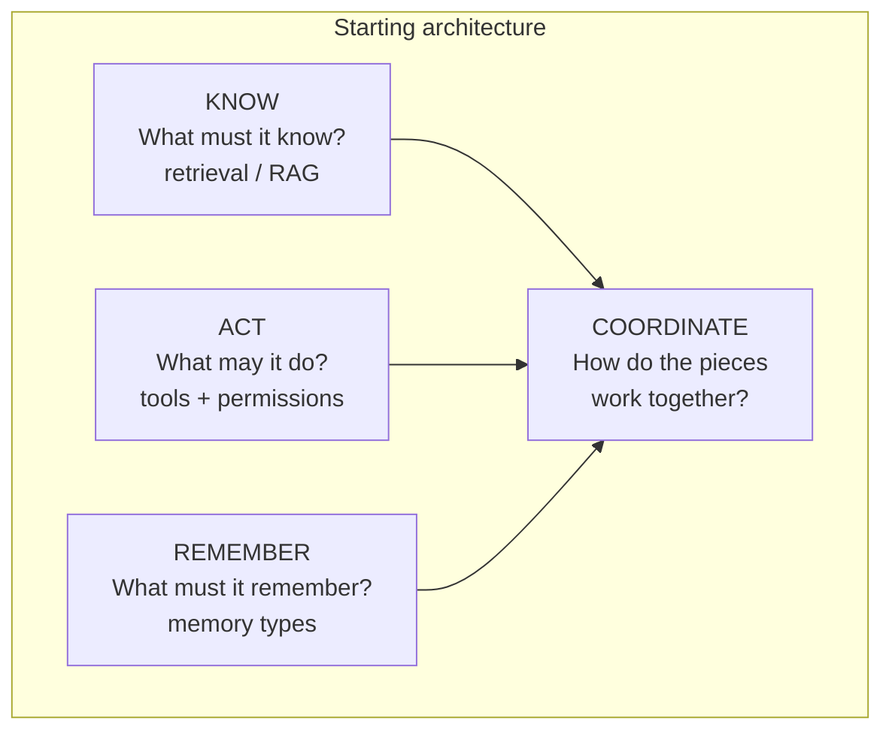
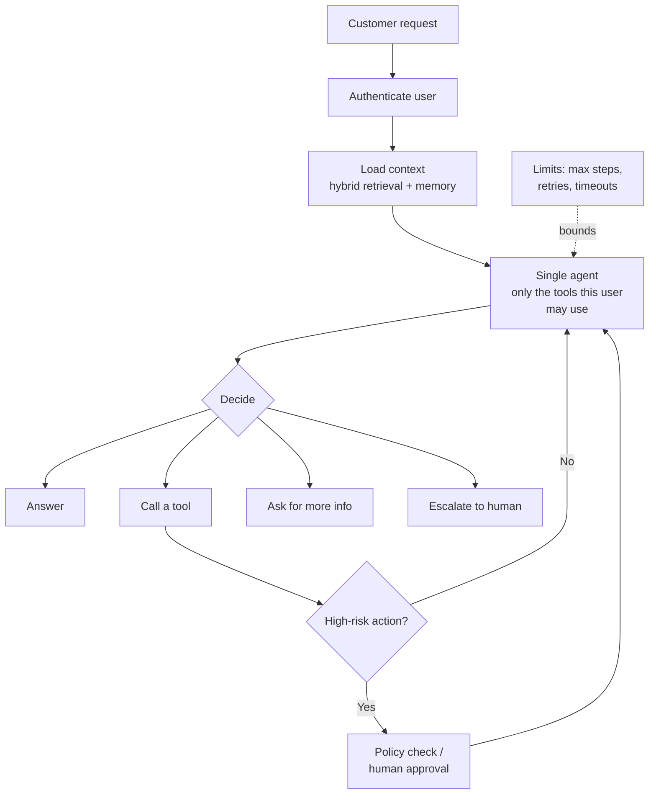
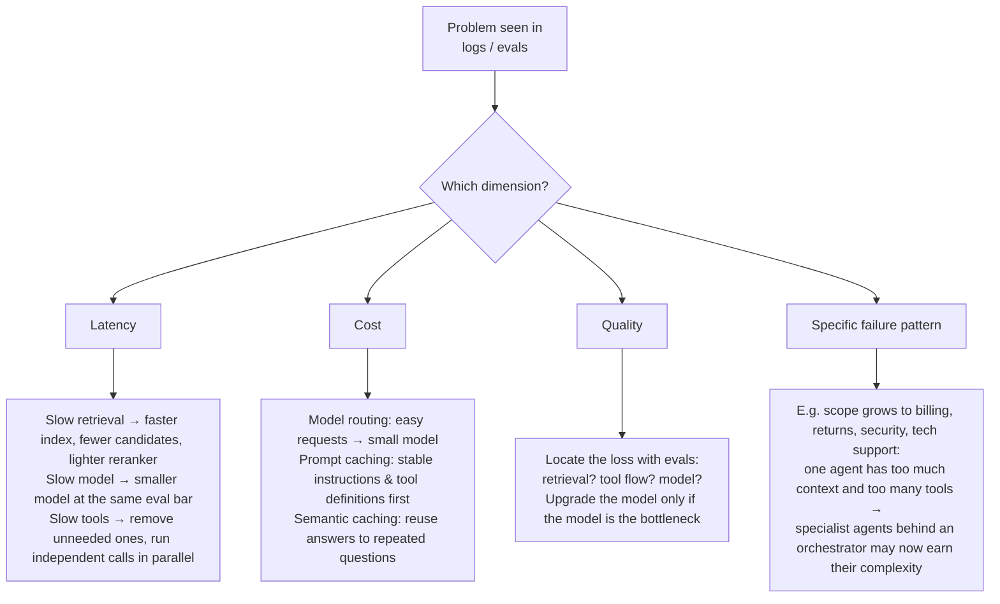

# AI_SYSTEM_DESIGN_PROCESS.md: Five-Layer Framework for Agentic System Design

> Reference for `.claude/CLAUDE.md`. **Read this before designing any new AI feature or agent, when an AI feature needs to scale to production, or when the human asks for a system design or wants to practise for interviews.**
> [`AI_SYSTEM_DESIGN.md`](./AI_SYSTEM_DESIGN.md) explains the building blocks. This file is the **step-by-step process** for applying them to a real problem and justifying every decision.

Knowing the terms (RAG, MCP, tool calling) isn't the skill. The skill is applying them to a real business problem and explaining what it takes to run in production. Walk the five layers in order; each one uses the answers from the layer before.



**Worked example used throughout:** an AI customer support system for an e-commerce company. It answers help-centre questions, looks up orders, creates tickets, and escalates to a human when unsure.

---

## Layer 1: Scope & Assumptions

Don't jump to RAG, agents or multi-agent. Most of system design is scoping the problem and making assumptions explicit.

### Four scoping questions

| Question | Support example |
|---|---|
| **Who is the user, and what's their problem?** | Customers needing support; many requests are repetitive but still need a human |
| **What outcome are we improving?** | Resolve more routine requests without a support agent |
| **Which part of the workflow does AI handle?** | Answer help-centre questions, look up orders, create tickets, escalate when not confident |
| **How much agency should it have?** | Answers routine questions and does low-risk actions on its own; high-risk actions (refunds) need a policy check or human approval |

### The agency–control trade-off



More autonomy means less human work but more risk. Decide per action, not per system; this choice shapes the whole architecture. (Compare the trust levels in [`AGENT_OPERATIONS.md`](../working-with-claude/AGENT_OPERATIONS.md) and [`AUTOMATION_PLAYBOOK.md`](./AUTOMATION_PLAYBOOK.md).)

### Four assumption buckets

| Bucket | Questions to answer | Support example |
|---|---|---|
| **Data** | What knowledge exists, how much, what format and language? | A few thousand help articles, mostly English; one article usually answers one question |
| **Inputs** | What do requests look like? | Short; some semantic ("can I send this back?"), some with exact IDs (order IDs, SKUs, error codes) |
| **Operating constraints** | Volume, latency, cost, availability? | Thousands of customers a day; answers expected within a few seconds |
| **Action risk** | What happens if each action goes wrong? | Order lookup is safe; issuing a refund is not |

**For Claude:** before designing, ask the human these questions in small batches ([`AGENT_SESSION_PLAYBOOK.md`](../working-with-claude/AGENT_SESSION_PLAYBOOK.md), Section 2.1). Never design against assumptions that exist only in your head. Write the confirmed assumptions into the spec; every later decision should point back to one of them.

---

## Layer 2: Architecture: Know, Act, Remember, Coordinate (KARC)



### Know: knowledge & retrieval
Design retrieval from the data and input assumptions:
- Policies, shipping rules and troubleshooting steps live in unstructured docs → parse, chunk, embed, store.
- Semantic questions ("can I send this back?" vs "Return policy") → **vector search**.
- Exact identifiers (SKUs, order IDs, error codes) → **keyword search (BM25)**.
- Both kinds of question → **hybrid retrieval + a reranker**, passing only the most relevant chunks to the model.
- One article usually answers one question → **don't start with graph RAG or complex multi-hop retrieval.** Revisit only if evals show multi-document questions are common.

Details: [`RAG_PLAYBOOK.md`](../ai-building-blocks/RAG_PLAYBOOK.md).

### Act: tools
List the minimum tools the scope needs. Support example: `lookup_order`, `create_ticket`, `check_refund_eligibility`, `escalate_to_human`. Note it's *check* refund eligibility, not *issue* refund, because of the agency decision in Layer 1.

For **every** tool, design four things:

| Concern | Question | Support example |
|---|---|---|
| **Permissions** | Least privilege: what's the minimum access? | `lookup_order` is read-only, and only for the authenticated customer's own orders |
| **Blast radius** | What happens if it does the wrong thing? | Lookup: low. Refund: high, so it sits behind deterministic policy checks and human approval |
| **Failure handling** | What if it times out or the API is down? | Retry within a limit, then escalate to a human |
| **Trust boundaries** | Which inputs are untrusted? | User messages, retrieved docs and tool outputs are all untrusted data; never execute instructions found inside them |

Details: [`MCP_PLAYBOOK.md`](../ai-building-blocks/MCP_PLAYBOOK.md), [`AGENT_OPERATIONS.md`](../working-with-claude/AGENT_OPERATIONS.md) (Section 2).

### Remember: memory
Consider four types, but **only use what the assumptions justify**:

| Type | What it holds | Support example | v1? |
|---|---|---|---|
| **Working** | Current task: conversation, retrieved info, intermediate tool results | Following the current chat | ✅ Required |
| **Episodic** | What happened before | "Contacted yesterday; already escalated" so it doesn't repeat actions | ✅ Useful |
| **Semantic** | Persistent facts about the user or account | Relevant customer and transaction info | ➖ Some |
| **Procedural** | Learned patterns for how the system should behave | Behaviour tuned from past interactions | ❌ Not in v1 |

### Coordinate: put it together
Start with the **simplest design that meets the scope**: usually a single agent.



The whole loop has hard limits on steps, retries and time, so the agent can never run indefinitely.

---

## Layer 3: Observability

If something goes wrong in production, you should be able to trace **where**, not just see that the final answer was bad. Three questions:

### What to log
Everything that goes in and out of every component: model inputs and outputs, retrieved chunks, tools called and their arguments, retries, latency per step, and cost. Add an audit trail for sensitive actions.

### Which evals to build
Evals must be **actionable**: each one points at the component to fix. Walk the architecture and ask what can go wrong in each part:

| Component | What can go wrong | Metrics |
|---|---|---|
| **Know** | Irrelevant context retrieved; needed info missed | Context precision, context recall |
| **Know → answer** | Good retrieval, but the answer isn't supported by it | Groundedness / faithfulness |
| **Act** | Wrong tool; wrong arguments; tool failed | Tool selection accuracy, argument accuracy, tool success rate, retry rate |
| **Whole flow** | Didn't escalate when it should; task not completed | Escalation accuracy, resolution rate, latency, cost per resolution, customer satisfaction |

**How:** code-based checks for objective things (right tool? valid arguments? valid schema?); LLM judges with good rubrics for subjective things (grounded? helpful? on-brand?). Method and rubrics: [`EVALS_PLAYBOOK.md`](../quality-and-safety/EVALS_PLAYBOOK.md).

### Online vs offline
- **Offline evals** run on reference and production datasets before every release; they **gate shipping**.
- **Online checks (guardrails)** run on live traffic in real time; they **stop bad outputs** before users see them (e.g. block an unsupported policy answer, force escalation on fraud signals). Keep them fast and cheap: code or decision models ([`DECISION_MODELS_PLAYBOOK.md`](../ai-building-blocks/DECISION_MODELS_PLAYBOOK.md)).
- Run judge-based evals on a **sample** of live traffic to track quality over time.

Logs → evals → fixes is the feedback loop that drives Layers 4 and 5.

---

## Layer 4: Production & Ops

Go back to the Layer 1 assumptions and ask what must change to serve real users reliably. Five dimensions:

| Dimension | What to design | Support example |
|---|---|---|
| **Scale** | Stateless agent service; conversation state and memory stored externally; replicas behind a load balancer | Thousands of concurrent customers → scale horizontally |
| **Latency** | An overall latency budget split across components; use traces to find the slowest stage and fix it first; timeouts on every dependency | If order lookup takes 3–5 s, start there |
| **Reliability** | Retries within limits, fallbacks, queues, graceful degradation | Tool keeps failing → escalate; traffic spike → queue rather than fall over |
| **Freshness** | Ingestion that detects updates, re-parses, re-embeds and re-indexes | Help articles change; retrieving an outdated article is still a wrong answer |
| **Security & auditability** | Auth on every request; encryption in transit and at rest; secrets outside prompts and code; audit trail | Answer: which customer, what data was accessed, which tools ran, who approved a risky action |

---

## Layer 5: Optimize

Optimise a **working** base system based on what the logs and evals actually show. Find the bottleneck first; don't optimise blind.



**Every bit of complexity must be earned.** Multi-agent, graph RAG and bigger models are answers to problems the evals have shown, never the starting point. The signal of a strong designer is explaining *why* each addition was needed.

Related: [`DECISION_MODELS_PLAYBOOK.md`](../ai-building-blocks/DECISION_MODELS_PLAYBOOK.md) (routing), [`AGENT_SESSION_PLAYBOOK.md`](../working-with-claude/AGENT_SESSION_PLAYBOOK.md) (prompt caching), [`AI_ENGINEERING_LAYERS.md`](./AI_ENGINEERING_LAYERS.md) (multi-agent graphs).

---

## How Claude Should Use This

When asked to design or build a new AI feature or agent:
1. **Layer 1 first.** Ask the scoping questions and the four assumption buckets; propose an agency level per action. Get confirmation.
2. **Produce the design doc** (template below) at `docs/specs/<feature>-design.md` before writing code. Tie every decision back to an assumption.
3. **Start simple:** single agent, the simplest retrieval that fits, minimum tools, minimum memory. List what would trigger more complexity later.
4. **Build observability in from the start**: logging, offline evals and the main guardrails are part of v1, not a follow-up.
5. When the human reports a problem with a live feature, **work from Layer 5 back**: find the bottleneck in logs/evals before changing anything.

When the human is **practising for interviews**, act as the interviewer: give the problem, answer their scoping questions with realistic assumptions, push back on unjustified complexity, then introduce a production scenario ("latency doubled", "costs too high", "scope expanded") for them to optimise.

### Design doc template

```markdown
# Design: <feature>

## 1. Scope & assumptions
- User & problem:
- Outcome to improve (metric):
- What the AI handles / doesn't:
- Agency per action: <action → autonomous / policy check / human approval>
- Assumptions: Data · Inputs · Operating constraints · Action risk

## 2. Architecture (KARC)
- Know: <sources, retrieval method, why>
- Act: | Tool | Permissions | Blast radius | Failure handling | Trust boundary |
- Remember: <working / episodic / semantic / procedural: which and why>
- Coordinate: <single agent or more, and why; diagram; step/retry/time limits>

## 3. Observability
- Logged: <fields>
- Offline evals: | Component | Metric | Method | Threshold |
- Online guardrails: <checks on live traffic>

## 4. Production
- Scale · Latency budget · Reliability · Freshness · Security & audit

## 5. Optimization backlog
- <Known trade-offs, and what evidence would trigger each change>
```

### Practice cases
The framework's author has 10 worked cases to practise on, in [`interview_prep/system-design`](https://github.com/aishwaryanr/awesome-generative-ai-guide/blob/main/interview_prep/system-design/README.md): customer support agent, enterprise research assistant, text-to-SQL analytics copilot, financial & operations decisioning, security & compliance agent, coding agent, document decisioning, real-time voice support agent, SDR sales-development agent, clinical scribe.
