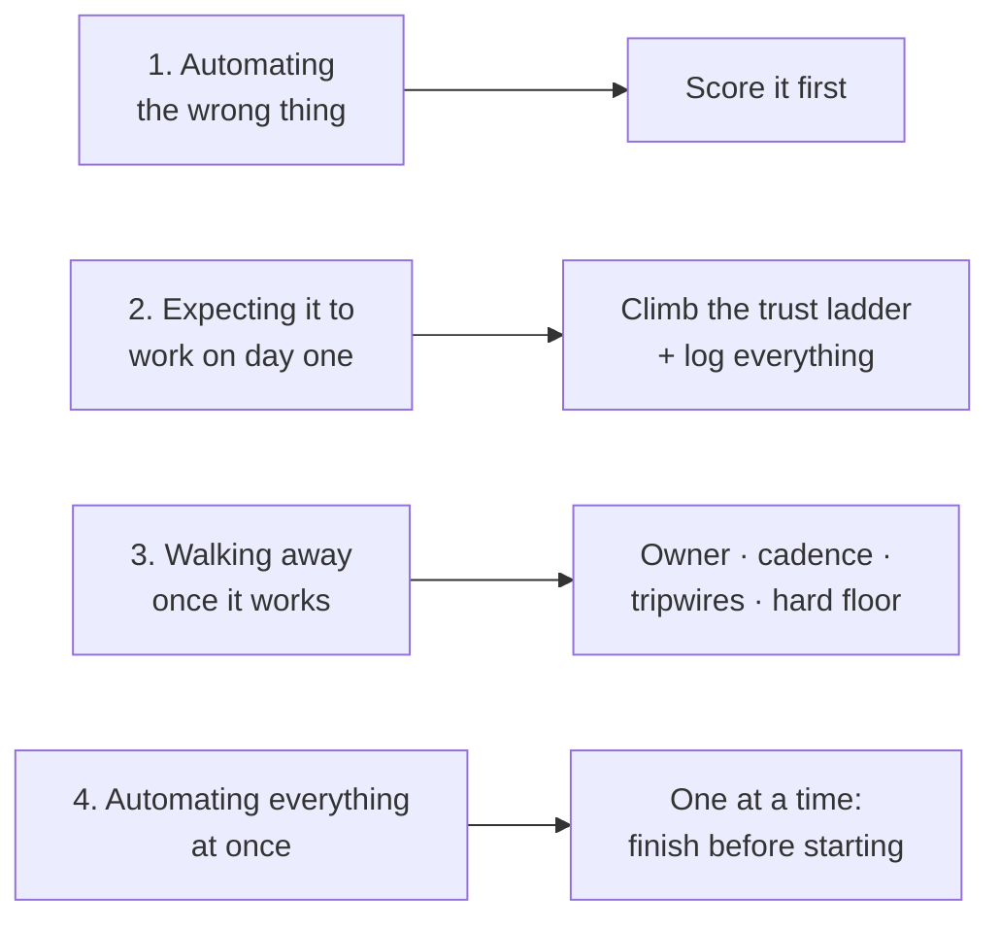
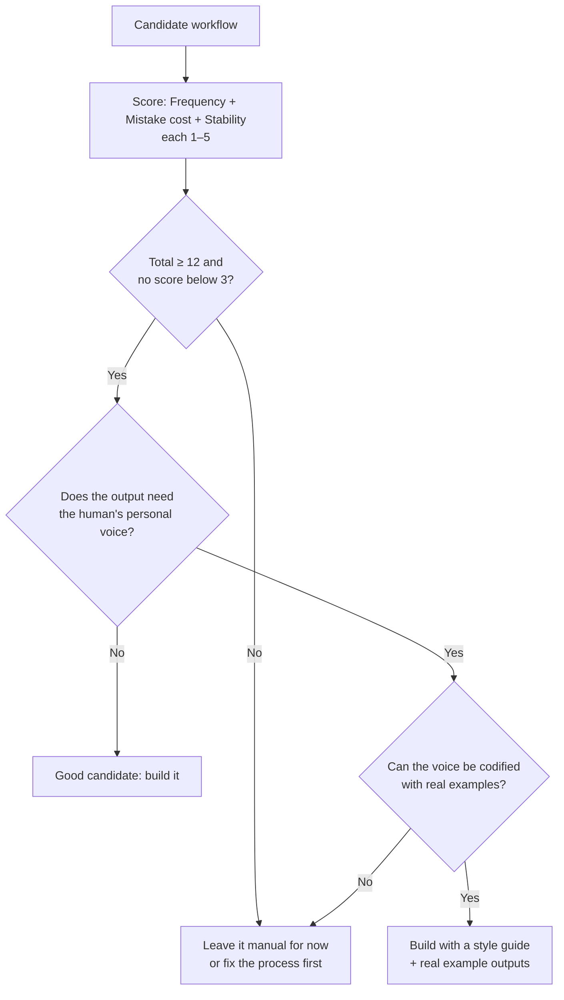
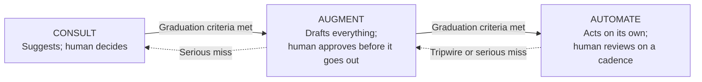
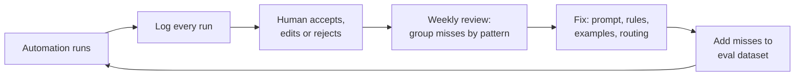
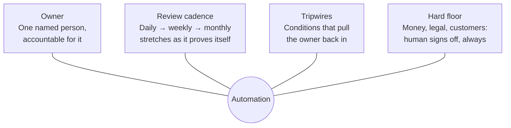
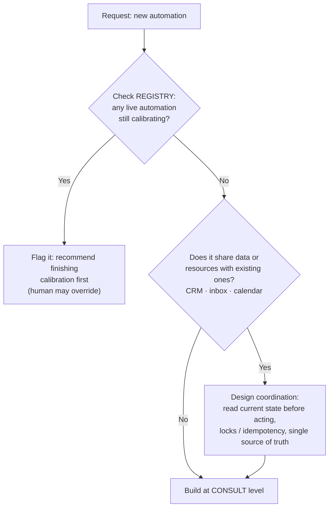

# AUTOMATION_PLAYBOOK.md — Building AI Agents That Actually Work

> Companion to [`WORKFLOW.md`](../working-with-claude/WORKFLOW.md). **Read this whenever a task builds, changes or extends an automation**: an AI agent, workflow, bot, scheduled job, or pipeline that does work in place of a person (triaging tickets, categorising expenses, following up leads, drafting replies, etc.).
> [`AI_SYSTEM_DESIGN.md`](./AI_SYSTEM_DESIGN.md) covers how to build the AI parts. This file covers **what to automate, how to roll it out, and how to keep it healthy**.

Automations don't run themselves forever after a weekend build. They are earned step by step, logged, owned, and introduced one at a time. This file prevents the four most common mistakes:



---

## 1. Decide What to Automate (Score It First)

Automating a rare or broken workflow just builds a faster way to be wrong. Before building any automation, score the workflow on three questions, **1–5 each, where 5 favours automation**:

| Question | 1 (don't automate) | 5 (automate) |
|---|---|---|
| **Frequency:** how often does it run? | Monthly or rarer | Many times a day |
| **Mistake cost:** what does one error cost? | Damages money, legal standing, a key relationship, or reputation | Cheap and easy to fix |
| **Stability:** how often do the steps change? | Different every time | Nearly identical every time |



Rules for the agent:
- When asked to build an automation, **score it in the spec** and show the scores. If it scores poorly, say so and suggest a better-scoring workflow before building.
- **Boring and high-volume beats impressive and rare.** Support-ticket triage wins; a monthly investor update loses.
- **Voice-specific work** (upset-customer replies, hard feedback, investor notes) is either codified with real examples from the human (stored in `docs/automations/<name>/voice/`), or left manual. Never ship generic output and hope it sounds right.
- Don't automate a broken process. If the steps are inconsistent, propose fixing the process first.

---

## 2. Expect Day One to Be Imperfect: Climb the Trust Ladder

A first version that is right 80% of the time is a starting point, not a failure. Don't scrap it; calibrate it with small weekly fixes (Kaizen). Small corrections that compound beat one big rebuild.

Every automation starts at **Consult** and climbs only when the logs show it has earned trust (levels match [`AGENT_OPERATIONS.md`](../working-with-claude/AGENT_OPERATIONS.md), Section 5):



- **Graduation criteria** are set by the owner in the automation spec, e.g. "≥ 200 runs and ≥ 95% accepted without edits over the last 2 weeks, and zero misses in protected categories (refunds, legal, VIP customers)."
- Promotion is a **human decision**. The agent may recommend it with numbers from the logs, never do it alone.
- Demote immediately after a serious miss or a tripwire breach.

### The logging flywheel
Without logs, every change is a guess. Every automation must log every run from day one.



**Minimum log fields per run:** run ID · timestamp · automation name & version (prompt/model/config) · input reference (not raw personal data) · decision/output · confidence if available · trust level at the time · human action (accepted / edited / rejected / not reviewed) · the correct outcome when a human corrected it.

**Weekly review** (the agent can run it on request, or as a scheduled task):
> Here are the cases this automation got wrong this week, each with what should have happened. Group them by underlying mistake, propose a specific fix for each group, and add them to the eval dataset.

Example: if refund requests keep getting filed as general questions, the fix is a rule plus labelled examples for the refund category, and a tripwire for it. It is not a rebuild.

---

## 3. Never Fully Walk Away: Ownership & Oversight

An automation that has run cleanly for months can still break silently (e.g. a vendor changes its invoice format and expenses get miscategorised for weeks). The more you hand to a machine, the more it depends on someone catching what it can't handle: autopilot flies the plane, but pilots stay in the cockpit.

Every automation must define these four things before it goes live:



- **Owner:** one named person. Anyone may *propose* a change; only the owner *approves and commits* it. The agent proposes changes as PRs or drafts and never merges changes to an automation the human doesn't own.
- **Review cadence:** starts frequent and stretches only as the logs justify it. Never drops to "never".
- **Tripwires:** implemented in code, alerting the owner when hit. Examples:
  - An amount above a threshold (e.g. refunds over a set value)
  - A message from or to a VIP or flagged customer
  - A metric spiking outside its normal range (volume, error rate, cost, a category suddenly growing)
  - Low model confidence, or an input format the automation hasn't seen before
  - Input source schema/format changes (catch the "vendor changed their invoice" case)
- **Hard floor:** anything legal, touching money, or sent to customers requires human sign-off **regardless of trust level or track record**. The agent must not build a path that bypasses it.

---

## 4. One at a Time: Stop Starting, Start Finishing

Launching five automations at once is like hiring five employees on the same day and supervising none: outdated policies quoted, the same lead emailed three times, double-booked calendars, and then everything switched off. Each automation is a standing commitment that needs tending. **The real limit is how many you can keep healthy, not how many you can build.**



An automation is **calibrated** (healthy enough to add another) when it runs on real work with only minor oversight and its weekly miss count is trending down.

Rules:
- **Keep a registry** at `docs/automations/REGISTRY.md` (create it if missing) and update it whenever an automation is added, changed, promoted, demoted or retired.
- **Check the registry first** before building a new automation; flag any that are still calibrating.
- **Prevent collisions:** automations that touch the same systems must read current state before acting (e.g. check the CRM before emailing a lead), be idempotent, and avoid double-acting (e.g. two agents booking the same calendar slot).
- **No stale knowledge:** policies, prices and rules an automation relies on must come from a single maintained source, with a "last verified" date, never copied into prompts and forgotten.

### Registry template

```markdown
| Automation | Purpose | Owner | Trust level | Review cadence | Tripwires | Hard floor | Status | Last reviewed |
|---|---|---|---|---|---|---|---|---|
| ticket-triage | Route support tickets | <name> | Augment | Weekly | Refund > $X; VIP sender | Refunds need human approval | Calibrating | 2026-11-05 |
```

---

## 5. Automation Spec (Add to the Feature Spec)

When the task builds an automation, add this block to the six-field spec in [`WORKFLOW.md`](../working-with-claude/WORKFLOW.md) (and the AI Design block from [`AI_SYSTEM_DESIGN.md`](./AI_SYSTEM_DESIGN.md) if it uses an LLM):

```markdown
## Automation Design
- **Workflow scores:** Frequency _/5 · Mistake cost _/5 · Stability _/5 → Total _/15
- **Voice-specific?** <no / yes: style guide + example location>
- **Starting trust level:** Consult
- **Graduation criteria:** <to Augment: ... / to Automate: ...>
- **Owner:** <name>  **Who can propose changes:** <names/roles>
- **Review cadence:** <start at ... ; may stretch to ...>
- **Tripwires:** <conditions + who gets alerted, how>
- **Hard floor:** <actions that always need human sign-off>
- **Logging:** <where run logs live; fields>
- **Shared systems & collision handling:** <CRM/inbox/calendar; how it avoids double-acting>
- **Kill switch:** <how to pause it instantly>
```

---

## The Whole Picture

- **Score before you build:** frequent, cheap-to-fix and stable work first; voice-specific work is codified or stays manual.
- **Climb the ladder:** Consult → Augment → Automate, earned from logs, with weekly small fixes.
- **Stay in the cockpit:** owner, review cadence, tripwires and a hard floor, always.
- **One at a time:** finish calibrating before starting the next.

The more powerful the automation, the more valuable the person directing it.
