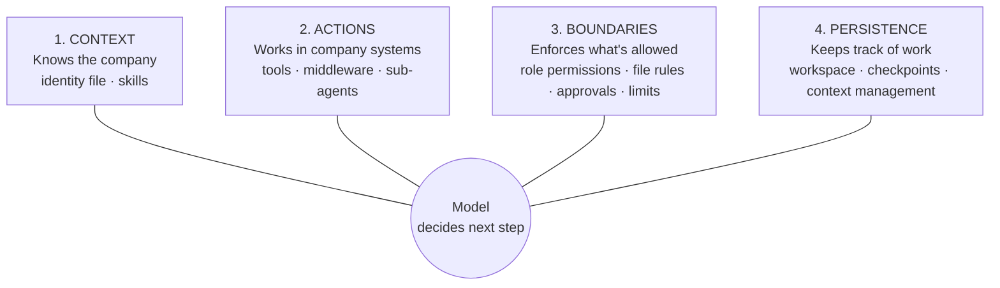
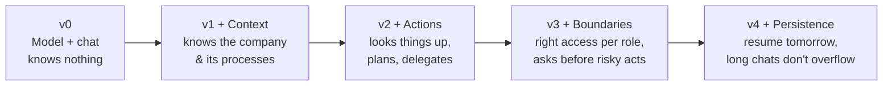
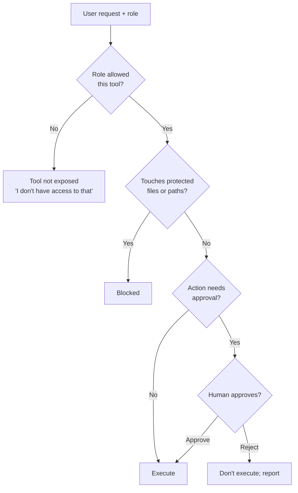

# HARNESS_ENGINEERING_PLAYBOOK.md: Building a Harness Around a Model

> Reference for `.claude/CLAUDE.md`. **Read this when a task builds an internal AI assistant or agent platform, adds context, tools, permissions or persistence to an agent, or uses an agent framework (e.g. LangChain Deep Agents).**
> Concepts: [`AI_ENGINEERING_LAYERS.md`](./AI_ENGINEERING_LAYERS.md) (Section 3). Overall design process: [`AI_SYSTEM_DESIGN_PROCESS.md`](./AI_SYSTEM_DESIGN_PROCESS.md). This file is the **hands-on build order**.

A **harness** is the software layer around a model that lets it complete real tasks: it supplies the right information, carries out actions, enforces what's allowed, and keeps track of work. The model only decides what to do next; the harness does everything else.

The harness matters as much as the model. Research reports the same model performing several times better with a better harness, which is why companies (e.g. Stripe, Ramp, Spotify) build their own internal harnesses around their own systems.

---

## The Four Components



Build them **in this order**, testing a working version after each one:



**Worked example:** *NS Work*, an internal harness for an analytics company (Northstar) serving sales, engineering and finance.

---

## 1. Context

Goal: employees never have to re-explain the company.

### Always-loaded identity file
Company basics and working conventions in one file (e.g. `AGENTS.md`), loaded into every conversation like a system prompt.
- What the company does, products, teams, key terms.
- Conventions, e.g. "be concise", "cite record IDs for every fact".
- **Keep it lean:** it costs tokens on every message ([`AGENT_SESSION_PLAYBOOK.md`](../working-with-claude/AGENT_SESSION_PLAYBOOK.md), Section 1.2).

### Skills
Repeatable processes written once, loaded only when needed:
- **Company-level:** e.g. `write-proposal` (required sections: scope, assumptions, pricing, timeline…).
- **Team-level:** e.g. engineering `triage-issue`.

Structure: one folder per skill with a `SKILL.md` (inputs, process, output format, hard rules); see [`AGENT_OPERATIONS.md`](../working-with-claude/AGENT_OPERATIONS.md), Section 3.

**Test:** "Draft a proposal for Acme using our proposal skill." It should follow the skill's sections. *Gap left:* the user still has to paste who Acme is.

---

## 2. Actions

Goal: the harness pulls facts from company systems itself.

### Tools
Wrap existing internal APIs and queries as tools, each with a clear name, a description of **when** to use it, and a strict input schema.

| Tool | Does | Type |
|---|---|---|
| `get_customer(name)` | Customer record from CRM | Read |
| `lookup_issue(id)` | Issue from the tracker | Read |
| `get_revenue(period)` | Revenue figures | Read (sensitive) |
| `send_proposal(customer, email, doc)` | Sends or queues a proposal | **Write / external** |

Internal tools shared across apps are good MCP server candidates ([`MCP_PLAYBOOK.md`](../ai-building-blocks/MCP_PLAYBOOK.md)).

### Middleware: code hooked into the agent loop
Runs before or after model calls and around tool calls, so behaviour is **enforced by code**, not just requested in a prompt:
- **Call limits:** stop after N model or tool calls so the agent can't loop forever.
- **Planning / to-do list:** the agent writes a step list for long tasks; it's useful for auditing and improving the harness.
- Others worth considering: logging and tracing every call, PII redaction, retries with backoff, cost tracking.

### Sub-agents
Specialists with their own instructions, model and tools that the main agent delegates to. Used for **parallel work** and **clean context**.
- Example: `proposal-reviewer` checks a draft against customer facts and flags unsupported commitments. It's an independent checker that never saw the drafting.
- Give each one only the tools it needs; a smaller, cheaper model is often enough.
- Add one only when it earns its complexity ([`AI_SYSTEM_DESIGN.md`](./AI_SYSTEM_DESIGN.md), Section 4).

**Test:** "Draft a proposal for Acme and review it." It should load the skill, call `get_customer`, write a plan, and delegate to the reviewer.

---

## 3. Boundaries

Goal: the harness enforces what each user and action is allowed. **Enforce these in code; prompts alone are not a security boundary.** Full threat model and tests: [`AI_SECURITY_PLAYBOOK.md`](../quality-and-safety/AI_SECURITY_PLAYBOOK.md).



### Role permissions
Map roles to tools, and only **expose** the allowed tools to the agent (don't just tell it not to use the others):

```python
ROLE_TOOLS = {
    "sales":       ["get_customer", "send_proposal"],
    "engineering": ["lookup_issue"],
    "finance":     ["get_revenue"],
}
```

Resolve the role from the **authenticated user**, never from what the user types. Test the negative path: an engineer asking about revenue must get "no access", not data.

### File permissions
Users can write to their workspace; **company context and skills folders are read-only** to the agent and changed only by harness maintainers.

### Approvals (human-in-the-loop)
Interrupt before high-risk actions (sending externally, payments, deletions) and allow only **approve / reject**. Also validate inputs in the tool itself, e.g. `send_proposal` rejects an email address that doesn't match the customer record.

### Limits
Call limits (Section 2), timeouts, and spend caps per user or task.

---

## 4. Persistence

Goal: start a long task today, continue it tomorrow.

- **Writable workspace:** a scoped folder where the agent saves outputs. For anything beyond a local prototype, use a **sandbox** so the agent can't reach the rest of the machine or network.
- **Checkpoints:** save conversation state (messages, metadata, plan) to a store (SQLite for a prototype, Postgres or similar in production) keyed by user and thread, so a user can list and resume past tasks.
- **Context management:** summarise older messages when the conversation passes a token threshold, keeping the most recent messages verbatim (e.g. summarise past ~12k tokens, keep the last 6 messages). Tune per use case, and make sure summaries keep decisions, open items and IDs ([`AGENT_SESSION_PLAYBOOK.md`](../working-with-claude/AGENT_SESSION_PLAYBOOK.md), Section 3.3).

**Test:** start a task, close it, reopen it, and continue with full context.

---

## Beyond v4

- **Per-user memory** (preferences, ongoing projects) on top of shared company context.
- **Scheduled tasks** (e.g. a daily brief), following the loop rules in [`AI_ENGINEERING_LAYERS.md`](./AI_ENGINEERING_LAYERS.md) (Section 4) and [`AUTOMATION_PLAYBOOK.md`](./AUTOMATION_PLAYBOOK.md).
- **Observability and evals**: trace every step, and add evals for tool choice, permission enforcement and approvals ([`EVALS_PLAYBOOK.md`](../quality-and-safety/EVALS_PLAYBOOK.md)).
- **Production:** auth, secrets management, multi-tenant isolation, scaling ([`AI_SYSTEM_DESIGN_PROCESS.md`](./AI_SYSTEM_DESIGN_PROCESS.md), Layer 4).

---

## Example Library: LangChain Deep Agents

The video builds NS Work with [Deep Agents](https://docs.langchain.com/oss/python/deepagents/), which provides the agent loop plus hooks for each component. Names as used in the video (**verify against current docs before coding**; the API is evolving):

| Component | Deep Agents feature (per video) |
|---|---|
| Base agent | `create_deep_agent(model=..., ...)` |
| Context | `memory=` (always-loaded files such as `AGENTS.md`) · skills directory |
| Actions | `tools=` · `subagents=` (name, prompt, model, tools) · `middleware=` (e.g. model-call limit, to-do list) |
| Boundaries | role-filtered `tools` · filesystem permissions · `interrupt_on={"send_proposal": approve/reject}` |
| Persistence | writable workspace backend · checkpointer (e.g. SQLite) · summarization middleware |

Reference code: [build-your-own-harness guide](https://github.com/aishwaryanr/awesome-generative-ai-guide/blob/main/youtube/build-your-own-harness.md) (notebook in `youtube/code/ns-work-harness/`, synthetic data, local only).

Other frameworks work too; the four components are the same. Pick a framework only after the human approves the dependency.

### Your own Claude Code setup is a harness too

| Component | In this repo |
|---|---|
| Context | `.claude/CLAUDE.md` (always loaded) · `.claude/skills/` · `docs/agent/` playbooks |
| Actions | Built-in tools · MCP servers (`.mcp.json`) · sub-agents |
| Boundaries | Permission rules in `.claude/settings.json` · hooks · approval prompts |
| Persistence | Sessions, rewind and checkpoints · auto memory · `progress.md` handoffs |

---

## Harness Spec Block (add to the design doc)

```markdown
## Harness
- **Users & roles:** <roles and what each needs>
- **Context:** <identity file contents; skills: company / team>
- **Tools:** | Tool | Read/Write | Roles allowed | Needs approval? | Input validation |
- **Middleware:** <limits, planning, logging, redaction, retries>
- **Sub-agents:** <name: job, model, tools; why it's needed>
- **Protected paths:** <read-only folders>
- **Persistence:** <workspace/sandbox; checkpoint store; summarisation thresholds>
- **Framework:** <name + pinned version>
- **Tests:** <per component, including negative permission tests>
```
