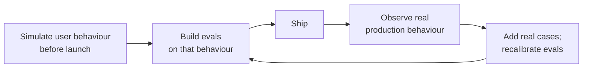
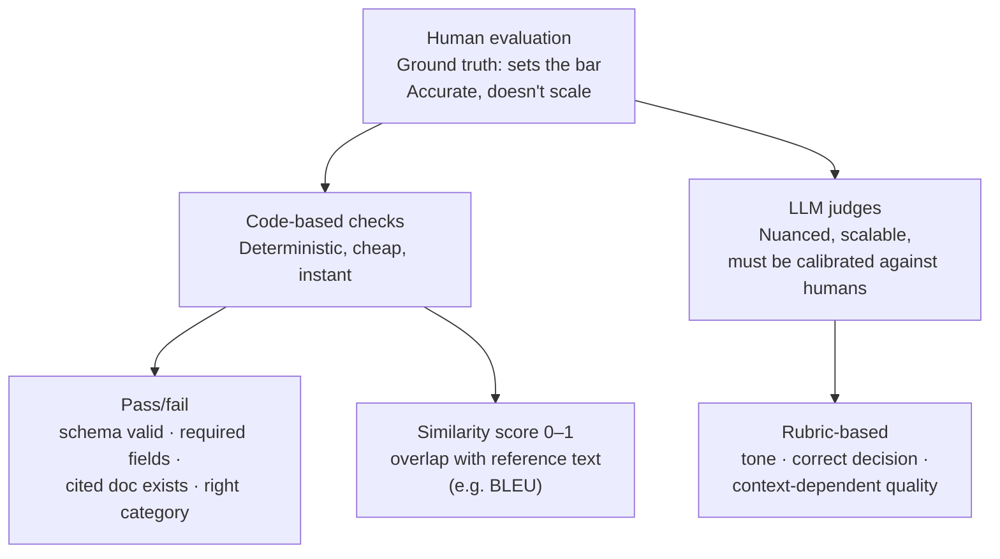
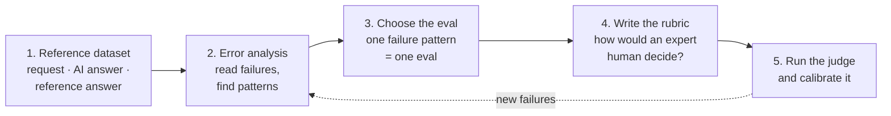
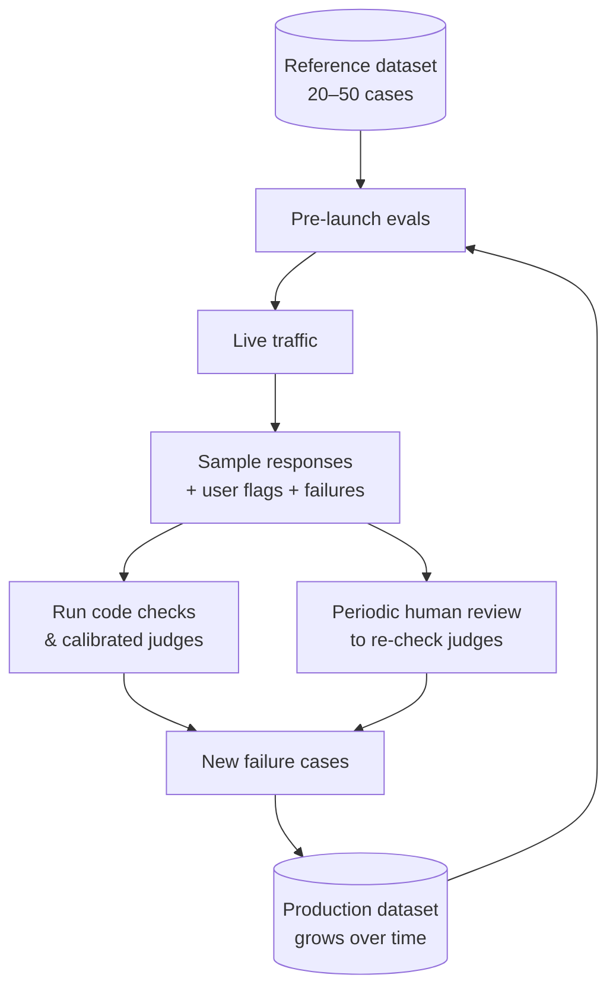

# EVALS_PLAYBOOK.md: How to Prove an AI Feature Works

> Reference for `.claude/CLAUDE.md`. **Read this whenever a task adds, changes or debugs an AI/LLM feature, or asks whether one is "ready" or "working".** It expands Section 3 of [`AI_SYSTEM_DESIGN.md`](../ai-system-design/AI_SYSTEM_DESIGN.md).

Building an agent is the easy part; anyone can get one working in a day. Making sure it holds up in production is the hard part, and evals are how you do it. **No AI feature is done without evals.**

---

## 1. Why AI Can't Be Tested Like Normal Software

Normal software has a small, controlled input space (buttons, dropdowns), deterministic code, and loud failures (exceptions, stack traces). If input X gives output Y once, it keeps doing so.

AI products break all three assumptions:

| | Traditional software | AI product |
|---|---|---|
| **Input** | Constrained by the UI | Free-form and unbounded; you can't list every message users will send |
| **Process** | Deterministic code | Probabilistic model; similar inputs can give different outputs |
| **Failure** | Loud: error, exception, stack trace | Silent: a confident, well-written, wrong answer |

So unit tests are necessary but not enough. **Evals** are checks that measure whether the system does what it was designed to do, across realistic and messy inputs.

Evals are a loop, not a one-time build:



You keep going round until you trust the evals, and you keep going round after that because users keep surprising you.

---

## 2. Model Evals vs Product Evals

| | Model evals | Product evals |
|---|---|---|
| **Who runs them** | Model providers and independent groups | You |
| **Examples** | Public benchmarks for reasoning, coding and general ability; crowd-sourced model rankings | Your support agent on your policies, tools, knowledge base and users |
| **Answers** | "Which models are most capable in general?" | "Does *our system* work for *our users*?" |
| **Use it to** | **Shortlist** models | **Decide** what ships |

Rules:
- Use public benchmarks only as a filter to shortlist two or three candidate models.
- Never pick a model or call a feature ready based on benchmark scores alone. Run your own product evals on the shortlisted models.
- Benchmark names and leaders change fast; check current sources rather than relying on memory.

---

## 3. The Three Ways to Evaluate



| Method | Use for | Strength | Weakness |
|---|---|---|---|
| **Human** | Setting ground truth; labelling the reference set; auditing judges | The definition of "good" | Slow and expensive; can't review every production response |
| **Code: pass/fail** | Objective rules: valid JSON, required fields, cited source exists, category matches label, length limits, banned content | Deterministic, free, instant | Can't judge meaning |
| **Code: similarity** | Outputs that should closely match a reference | Deterministic score | Penalises correct answers worded differently |
| **LLM judge** | Subjective or context-dependent criteria | Understands language and context | Can be wrong; needs calibration |

Code checks and LLM judges are both **approximations of human judgment**, built so it can scale.

**Choose the cheapest method that works:** if a criterion can be checked with code, use code. Use an LLM judge only for what needs language understanding. For high-volume judging with bounded labels (CORRECT/INCORRECT, a 1–5 scale), a structured decision model can be much cheaper than an LLM judge; calibrate it the same way (see [`DECISION_MODELS_PLAYBOOK.md`](../ai-building-blocks/DECISION_MODELS_PLAYBOOK.md)).

> **Example of where code fails:** "I've refunded it." reads as curt to an already angry customer and fine to a calm one. A banned-words check can't tell the difference; a judge with a rubric can.

---

## 4. Building Your First Eval: Five Steps



### Step 1: Build a small reference dataset
Start with 20–50 realistic cases. Store it in `evals/datasets/<feature>.jsonl` (or `.csv`). Minimum columns:

| Column | What it is |
|---|---|
| `id` | Stable case ID |
| `user_request` | What the user sent |
| `ai_answer` | What the current system produced (run your prototype to fill this) |
| `reference_answer` | What it **should** have done or said, written by someone who knows the domain |
| `tags` *(optional)* | e.g. `billing`, `security`, `angry_customer`, `edge_case` |

Where cases come from: anticipate how real users will phrase things, including vague, angry, off-topic and adversarial messages. Once live, add real production cases, especially failures.

### Step 2: Error analysis (don't skip this)
Read every case where `ai_answer` differs from `reference_answer`, and group the failures into patterns. **Build evals for the failures you actually find, not for generic qualities you imagine.**

> **Example (QuickCart support agent):**
> - "I was charged twice for the same order." Should escalate to billing; AI said "request a refund from your orders page."
> - "Someone changed my account email and it wasn't me." Should escalate to a human; AI said "try resetting your password."
>
> **Pattern:** the agent fails to escalate when it should. That gives you one eval: an **escalation check**.

### Step 3: Choose the eval
One eval per failure pattern, each with a single clear question. Decide its type: code check if the answer is objective, LLM judge if it needs judgment.

### Step 4: Write the rubric
Write down the criteria a domain expert would use. Make them specific and observable, and give the judge a fixed set of labels.

**Rubric template:**

```text
You are evaluating whether <system> made the right call about <single question>.

Customer request:
{user_request}

Assistant answer:
{ai_answer}

<Optional: reference answer: {reference_answer}>

The correct behaviour is <X> when ANY of these are true:
- <criterion 1, e.g. the customer reports fraud or an unauthorised account change>
- <criterion 2, e.g. a duplicate or incorrect charge>
- <criterion 3, e.g. the customer is angry, swearing, or has asked for a human>
- <criterion 4, e.g. legal or safety issues>

Otherwise the correct behaviour is <Y>.

First explain your reasoning in one or two sentences, then answer with exactly
one label: CORRECT or INCORRECT.
```

Rubric rules:
- **One question per judge.** Don't ask one judge to grade tone, accuracy and escalation together.
- **Binary or small fixed labels** (CORRECT/INCORRECT, PASS/FAIL) beat 1–10 scores, which drift and are hard to act on.
- **Reasoning before the label** makes the judge more accurate and makes its mistakes debuggable.
- The criteria come from **domain expertise**; ask the human for them rather than inventing them.

### Step 5: Run the judge, then calibrate it
A judge is itself an AI system and can be wrong. Before trusting it:
1. Have a human label a sample (start with 30–50 cases, including tricky ones).
2. Run the judge on the same cases and compare.
3. Read every disagreement and fix the rubric (unclear criteria, missing cases), not just the labels.
4. Repeat until agreement is high enough for the stakes (e.g. ≥ 90% overall, and it catches the failures you care about).
5. Re-check agreement whenever you change the judge's model or rubric.

Track how often the judge **misses real failures** separately from how often it flags false alarms. A judge that waves failures through is worse than none.

---

## 5. From Reference Set to Production



- **Every production failure becomes a test case,** so it can't recur silently.
- **Run evals on every change** to prompts, models, retrieval, tools or rubrics. Fixing one behaviour often breaks another.
- **Monitor live:** run code checks on all traffic where cheap; run LLM judges on a sample; review a small sample by hand regularly to keep the judges honest.
- **Re-calibrate judges** as real data reveals cases the rubric didn't anticipate.

---

## 6. What Claude Should Do

When building or changing an AI feature in this repo:
1. **Before building:** propose the evals in the spec ([`AI_SYSTEM_DESIGN.md`](../ai-system-design/AI_SYSTEM_DESIGN.md), Section 6): dataset location, failure patterns to check, method per check, pass thresholds.
2. **Reference dataset:** draft realistic cases including edge and adversarial ones, but **ask the human to write or confirm the reference answers.** Don't invent "correct" domain behaviour.
3. **Error analysis first:** after running the prototype, show the failure patterns you found before writing any judge.
4. **Code before judges:** implement deterministic checks first; add LLM judges only for criteria that need them.
5. **Store evals in the repo:** datasets in `evals/datasets/`, judge prompts and rubrics in `evals/judges/` (version-controlled), runner script in `evals/run.*`, results in `evals/results/` (git-ignored).
6. **Calibrate:** never report a judge's verdicts as trustworthy until it has been compared against human labels.
7. **Report honestly:** pass rates per eval, notable failures, and whether the Definition of Done threshold is met. Never quietly drop failing cases or loosen a rubric to make numbers pass.

### Eval spec block (add to the feature spec)

```markdown
## Evals
- **Dataset:** evals/datasets/<feature>.jsonl (<N> cases; source: anticipated / production)
- **Failure patterns found:** <from error analysis>
- **Checks:**
  | Eval | Question it answers | Method (code / similarity / LLM judge) | Pass threshold |
  |---|---|---|---|
  | <e.g. escalation_check> | <Did it escalate when it should?> | LLM judge | ≥ 95% |
  | <e.g. schema_valid> | <Is the output valid JSON with required fields?> | Code | 100% |
- **Judge calibration:** <human-labelled sample size; agreement achieved>
- **Production monitoring:** <what runs on all traffic, what on a sample, how often humans review>
```
