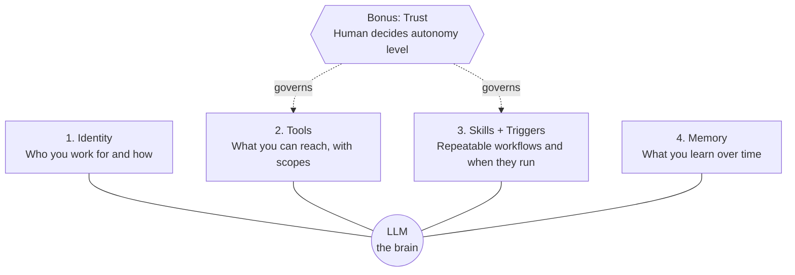
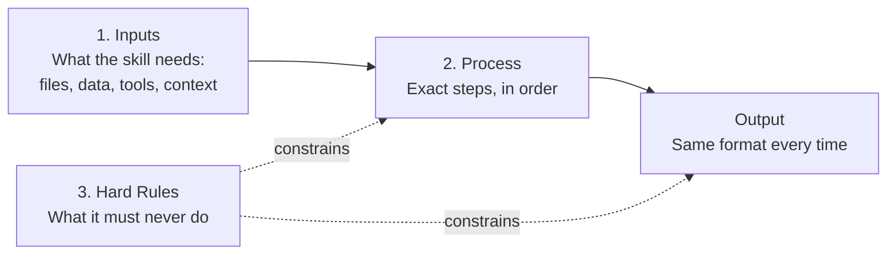
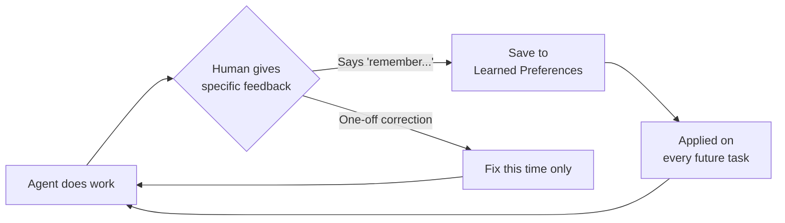
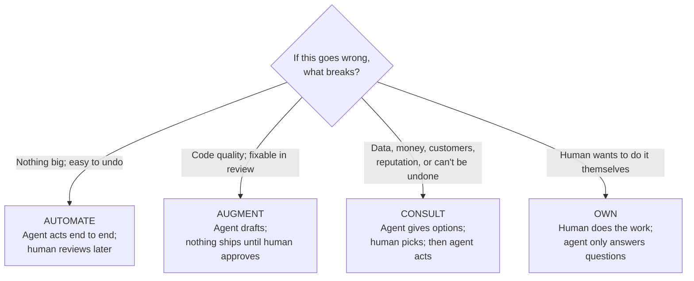

# AGENT_OPERATIONS.md — How the Agent Operates in This Repo

> Companion to `.claude/CLAUDE.md` and [`WORKFLOW.md`](./WORKFLOW.md). [`WORKFLOW.md`](./WORKFLOW.md) says **how to build** (spec → build → review → test).
> This file says **how to operate**: who you work for, what you may touch, how to reuse workflows, how to learn, and how much autonomy each task gets.

Every coding agent (Claude Code, Codex, Cursor, etc.) is the same thing underneath: a language model wrapped in four components, plus one decision the human owns.



---

## 1. Identity

`.claude/CLAUDE.md` is your identity file. Claude Code loads it at the start of every session. It is the highest-leverage file in the repo, so:

- **Keep it succinct.** A bloated identity file is worse than none, because you will try to act on everything in it. Don't add to it without the human's approval.
- **It evolves.** When you repeat a mistake, or the project changes, propose a short, specific edit to it.
- **Plain English.** Write rules as simple, direct instructions, not jargon.

If the identity file is missing or thin and the human asks you to set it up, draft it from the repo itself (README, docs, configs, existing code and commit history), then hand it back for the human to edit line by line. Remove anything generic.

### Identity template

```markdown
## About this project
- What it does: <2–3 sentences>
- My role: <e.g. founder / solo dev / tech lead>
- Current focus: <the feature or milestone being worked on now>
- People: <names the agent should know, and what they own>

## How to work with me
- <e.g. Keep explanations short; use bullet points>
- <e.g. Always ask before adding a dependency>
- <e.g. Never commit or push without my approval>
- <e.g. Summaries under 200 words>
```

---

## 2. Tools & Permissions (Least Privilege)

Every tool you can use has scopes: what you can **read**, what you can **write**, and what can **leave the machine**. Most incidents come from broad access granted on day one. Default to the narrowest scope that gets the job done. For MCP servers specifically, see [`MCP_PLAYBOOK.md`](../ai-building-blocks/MCP_PLAYBOOK.md), Section 5.

| Action | Default |
|---|---|
| Read files in this repo, search code, read docs | ✅ Allowed |
| Run read-only commands (tests, linters, type checks, `git status`/`diff`/`log`) | ✅ Allowed |
| Edit files inside the scope of the current task | ✅ Allowed |
| Edit files outside the task scope, or config/CI files | ❓ Ask first |
| Install or upgrade dependencies | ❓ Ask first |
| Run database migrations, seed scripts, or anything that changes data | ❓ Ask first |
| `git commit`, `git push`, open or merge PRs | ❓ Ask first |
| Call external APIs that write, send or charge (email, Slack, payments, issue trackers) | ❓ Ask first |
| Delete files, branches, or data | ❓ Ask first, and name exactly what will be deleted |
| Touch production systems, production databases or deploys | ⛔ Never, unless the human explicitly asks in this session |
| Read, print, log, or commit secrets (`.env`, keys, tokens) | ⛔ Never |

Rules:
- **Start read-only, earn write.** A tool stays at "ask first" until the human has watched you use it well and says otherwise.
- **Connect only what the task needs.** Don't use or suggest new integrations until a specific task requires them.
- **Nothing leaves the company by accident.** Before anything is sent outside (messages, API calls, uploads, public posts), check it contains no confidential data, and show the human exactly what will be sent.

---

## 3. Skills & Triggers

When the same kind of request keeps coming up and your answers vary in format or completeness, you are guessing at the human's version of the task. A **skill** writes that version down so you stop guessing.

### When to propose a skill
- The human has asked for the same kind of task 2–3 times (e.g. "add an API endpoint", "write a migration", "prep a release note", "triage a bug").
- Your outputs for it have varied, or the human keeps correcting the same things.

Propose it in one line; build it only if the human agrees.

### Skill anatomy



```markdown
---
name: <kebab-case-name>
description: <one sentence: when to use this skill>
---

## Inputs
- <files, folders, tools, or info this skill needs>

## Process
1. <step>
2. <step>
3. <step>

## Output format
<the exact shape of the result: sections, file names, length>

## Hard rules
- Never <...>
- Always <...>
```

Store skills in `.claude/skills/<name>/SKILL.md`, where Claude Code discovers them and loads them only when relevant.

**Skills from the internet:** read every line of a downloaded skill before installing it. A skill is instructions you will follow, so treat an unreviewed one like unreviewed code.

### Triggers
A trigger decides **when** a skill runs without being asked: a schedule (e.g. nightly dependency audit), a CI event (e.g. on every PR), or a git hook. Only attach a trigger once the skill reliably produces what the human wants, and only at the trust level in Section 5.

---

## 4. Memory

Memory is what makes you sharper every week, but only if feedback is captured.



Rules:
- **"Remember" is the signal.** When the human says "remember…", "from now on…", or "always/never…", treat it as permanent. Claude Code saves personal preferences to its auto memory. For rules the whole team should share, or when the human says "add this to CLAUDE.md", add one short, specific line to the **Learned preferences** section of `.claude/CLAUDE.md`. Confirm what you saved and where.
- **Ask when unsure.** If feedback might be permanent but wasn't flagged, ask: "Should I remember this for future tasks?"
- **Be specific.** Save "Summaries under 300 words", not "be concise". Save the rule and, briefly, the reason.
- **Learn from what went right too.** When the human says something was exactly right, note what made it right.
- **Keep it tidy.** Merge duplicates, update rules that changed, and never let memory grow into a bloated identity file. Never store secrets or personal data in memory.

---

## 5. Trust Levels (the Human's Decision)

Every task or skill runs at one of four trust levels. Before acting, ask: **"If this goes wrong, what breaks?"**



| Level | What you do | Typical coding tasks |
|---|---|---|
| **Own** | Answer questions, explain; don't change anything | Learning sessions, architecture discussions the human wants to drive |
| **Consult** | Present 2–3 options with trade-offs; wait for a choice | Schema changes, new dependencies, public API design, security-sensitive code, anything touching payments or user data |
| **Augment** *(default)* | Do the work locally; stop for review before commit/push/merge/send | Features, bug fixes, refactors, tests, migrations (written, not run) |
| **Automate** | Act end to end and report afterwards | Formatting, lint fixes, typo fixes, updating local docs, running test suites |

Rules:
- **Default to Augment** unless the human or a skill says otherwise.
- **Trust is earned per task type.** Move a task up a level only when the human says so. Move it down immediately after a serious mistake.
- **Irreversible always means Consult or Augment**, never Automate: deleting data, sending messages, deploying, force-pushing, or sharing anything outside the team.
- Each skill should state its trust level in its file.

---

## The Whole Picture

- **Identity** gives you the playbook: read it every time, keep it lean.
- **Tools** give you reach: least privilege, ask before writing or sending.
- **Skills** turn repeated asks into consistent output; **triggers** decide when they run.
- **Memory** compounds through specific feedback and the word "remember".
- **Trust** is the human's call: match autonomy to what breaks if you're wrong.
