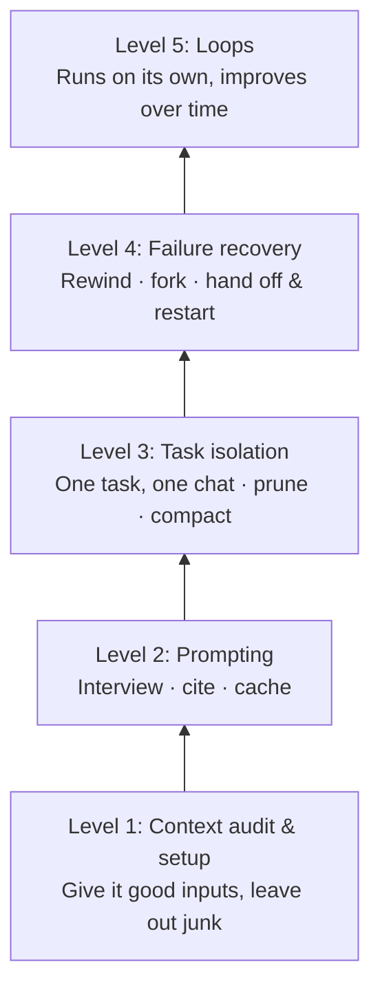
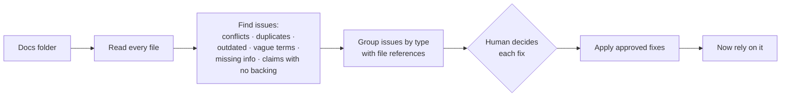
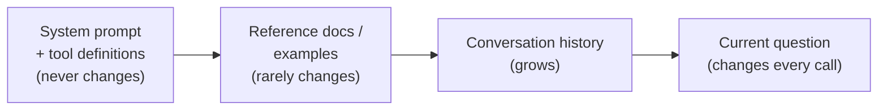
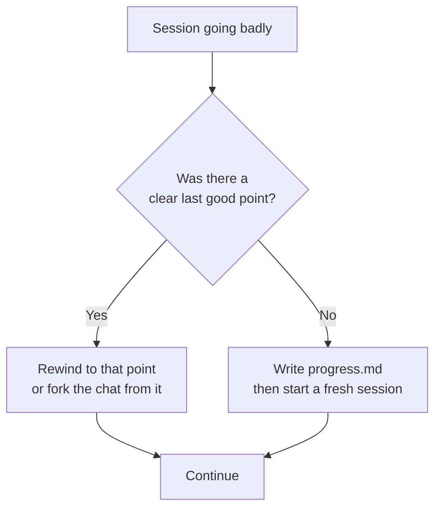

# AGENT_SESSION_PLAYBOOK.md — Cheaper Tokens, Better Results

> Companion to `.claude/CLAUDE.md` and [`AGENT_OPERATIONS.md`](./AGENT_OPERATIONS.md). **Read this for long or multi-session tasks, when a task depends on a folder of documents, when a conversation is going badly, or when the human asks about cost or efficiency.**
> It covers how you (the coding agent) should run a working session so the human gets better output for fewer tokens and fewer back-and-forths.

Getting real value from an agent isn't about better prompts alone. It's five levels; most people stop at level two.



---

## Level 1: Context Audit & Setup

Messy, outdated or contradictory inputs produce confident wrong answers. Fix the inputs before relying on them.

### 1.1 Audit context before relying on it
When a task depends on a folder of docs, data or notes you haven't verified (requirements, policies, specs, a knowledge base for RAG), **offer an audit first**:



Audit prompt the human can use (or you can propose):
> Audit everything in `<folder>` before I rely on any of it. Read every file and list every place where files conflict, are duplicated, look out of date, use vague terms, or are missing information. Group the issues and let's fix them.

Never silently "resolve" a conflict between documents; show it and let the human decide.

### 1.2 Keep the identity file short and human-owned
`.claude/CLAUDE.md` is read on **every** session, so every line costs tokens every time.
- The human writes it, or at least reviews every line. AI-written identity files tend to be generic, perform worse and cost more.
- Keep it to what's essential; put detail in linked files like this one that are read only when relevant.
- Propose additions sparingly, and propose removals when rules are stale.

### 1.3 Show, don't describe
Agents learn far better from examples than from adjectives like "professional" or "bold".
- Before producing anything with a house style (emails, docs, release notes, commit messages, API responses, UI copy), look for real examples in the repo: `examples/`, `templates/`, existing files of the same kind, git history.
- When the human gives examples, **name the patterns** you extracted (structure, length, tone, recurring moves) so they can confirm.
- Offer to **codify** confirmed patterns into a reusable template in `templates/` so future outputs stay consistent.

### 1.4 Turn off tools you don't use
Every connected tool's description is loaded into context on every message, whether used or not; many tools also lower accuracy.
- Don't request or suggest new tool connections unless a specific task needs them.
- If you notice many connected tools unrelated to this project, suggest the human disable them.

---

## Level 2: Prompting

### 2.1 Interview before building
For large or ambiguous tasks, don't guess. **Interview the human first**: ask focused questions in small batches, keep going until you have what you need, and don't start building until the details are agreed. This feeds directly into the spec ([`WORKFLOW.md`](./WORKFLOW.md), Section 2) and often surfaces things the human hadn't considered.

The human can trigger this with:
> Before you write anything, interview me. Ask questions one batch at a time and keep going until you have everything you need. Don't start until we've agreed on all the details.

### 2.2 Cite sources
Citing sources is one of the most effective ways to cut hallucination.
- Claims about this codebase → cite file paths and line numbers (`src/auth/session.ts:42`).
- Claims from docs, specs or tickets → name the document and section.
- Claims about libraries, APIs or current facts → cite the official docs you checked; say when you're relying on memory.
- If you can't find a source, say so rather than inventing one.

### 2.3 Context first, questions last (prompt caching)
Providers cache prompts from the top. Stable content at the start gets reused at a much lower price (often up to ~90% cheaper; check your provider's pricing); anything changed early invalidates everything after it.
- **In conversations:** put large documents first, then ask questions underneath.
- **In AI features you build in this codebase:** order prompts as stable prefix → semi-stable → per-request:



Don't put timestamps, request IDs or user-specific values at the top of a prompt; that breaks the cache for everything below. Use the provider's cache controls where available.

---

## Level 3: Task Isolation

Quality drops as a conversation grows (context rot), and you keep paying for old tokens.

### 3.1 One task, one chat
When the human switches to an unrelated task, suggest starting a fresh session. It improves quality and stops paying for unrelated context.

### 3.2 Prune context
- Read only the files relevant to the task; prefer targeted searches over opening whole directories.
- Don't paste large tool outputs, logs or files into the conversation when a summary or excerpt will do.
- Restrict work to the relevant folder or module when possible.
- For large or messy knowledge (many docs, notes, past decisions), build a **wiki**: short, curated, interlinked pages, one topic per page, with an index. The agent reads only the pages a task needs instead of the raw pile. Keep it audited (Section 1.1) and up to date. Full method: [`WIKI_PLAYBOOK.md`](./WIKI_PLAYBOOK.md).

### 3.3 Compact progress into a handoff file
For long or multi-day work, write a handoff file the human controls rather than relying on automatic compaction. Save it as `progress.md` (or `docs/progress/<task>.md` for several parallel tasks):

```markdown
# Progress: <task>
**Goal:** <one or two lines>
**Key decisions:** <decision, plus a few words on why>
**Done so far:** <bullets>
**Still open:** <unresolved questions and blockers>
**Next steps:** <ordered, most important first>
**Key files:** <paths>
```

Rules: no filler; terse enough to read in under a minute; detailed enough that a fresh session can continue without the old chat. Offer to write it at natural stopping points, and read it first when the human resumes.

---

## Level 4: Failure Recovery

### 4.1 Recognise when the thread is rotting
Signs: repeating mistakes that were already fixed, forgetting constraints or decisions, going in circles, answers getting vaguer, contradicting earlier work.



### 4.2 Say so, don't fight it
When you notice these signs, tell the human plainly, e.g.:
> This thread is degrading: I've reintroduced a bug we fixed earlier. I recommend rewinding to just after we agreed the schema, or I can write `progress.md` now and we continue in a fresh session.

Rewind and fork (where the agent supports them) are among the most underused features: they keep everything up to a good point and drop what went wrong after it.

---

## Level 5: Loops

A loop is a prompt the agent repeats on its own: do the work, check it, try again, stop. Every loop needs:

1. **A specific, checkable goal:** e.g. "check these 5 competitors for changes in pricing, features and positioning", not "keep an eye on competitors".
2. **A check:** how it verifies the goal was met (a test, a comparison against yesterday's snapshot).
3. **A cap and gate:** when it stops and reports back (after all 5 are checked; max runs; expiry; budget).
4. **Memory:** a file it reads and updates between runs (e.g. `snapshots/competitors.json`).

Plus a **trigger** (schedule or event) and clear **action limits**, e.g. "read and post a summary only; take no other action".

Example:
> Every morning, check our 5 competitors and compare each against yesterday's snapshot in `snapshots/competitors.json`. Flag only what changed. Save the updated snapshot. Post a short summary to Slack: what changed, for which competitor. Stop once all 5 are done. Take no action beyond reading and posting.

**Only loop what you understand well.** If you can't define "done", the check, or the stop condition, keep the task manual. Full loop and automation rules: [`AI_ENGINEERING_LAYERS.md`](../ai-system-design/AI_ENGINEERING_LAYERS.md) (Section 4) and [`AUTOMATION_PLAYBOOK.md`](../ai-system-design/AUTOMATION_PLAYBOOK.md).

---

## Session Checklist

**Before starting**
- [ ] Inputs audited if the task relies on docs/data you haven't verified
- [ ] Interviewed the human if the task is large or ambiguous
- [ ] Looked for existing examples/templates of the expected output
- [ ] Only relevant files and tools in play

**During**
- [ ] Sources cited (file:line, doc, official docs)
- [ ] Stable context first, questions last
- [ ] Suggested a fresh session when the task changed

**When stopping or stuck**
- [ ] `progress.md` handoff written for multi-session work
- [ ] Flagged thread rot and suggested rewind, fork or restart

**For recurring work**
- [ ] Loop has goal, check, cap/gate, memory, trigger and action limits
