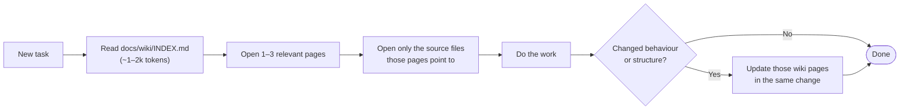
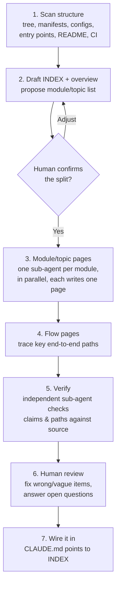
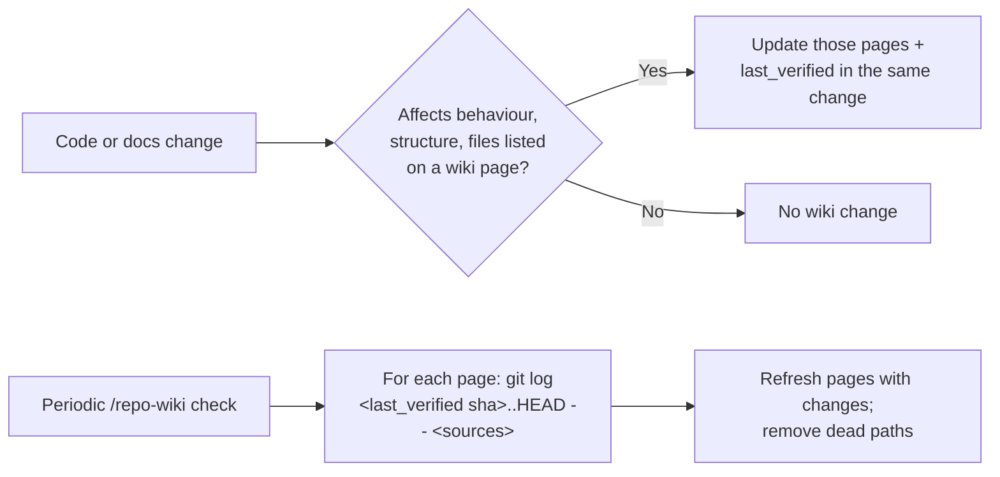

# WIKI_PLAYBOOK.md: A Navigable Wiki for a Large Codebase or Messy Folder

> Reference for `.claude/CLAUDE.md`. **Read this when asked to build, update or check the project wiki, when starting work in a large or unfamiliar repo or docs folder, or when you keep re-reading the same files to orient yourself.** The `/repo-wiki` skill (`.claude/skills/repo-wiki/SKILL.md`) runs these steps.

**Goal:** Claude should never read a whole codebase or folder to answer one question. A small, curated **wiki** gives it a map: read the index, open the one or two pages that matter, then go straight to the right files. Fewer tokens, less context rot, faster and more accurate work.



---

## 1. Principles

1. **The wiki is a map, not a copy.** Describe what lives where and why; link to `path/file.ext` (and line ranges for key spots) instead of pasting code. The code and original documents stay the source of truth.
2. **Small pages, one topic each.** Aim for under ~150 lines per page so any page is cheap to load.
3. **The index is the router.** `INDEX.md` answers "where do I go for X?" in one short file.
4. **Every page says what it's based on and when it was checked:** source paths, last-verified date and commit, so staleness is detectable.
5. **Built by the agent, reviewed by a human.** Claude drafts; the human corrects anything wrong or vague (`AGENT_SESSION_PLAYBOOK.md`, Section 1.2).
6. **Kept current as part of normal work.** A change that alters behaviour or structure updates the affected pages in the same change.

---

## 2. Structure

```
docs/wiki/
├── INDEX.md              ← router: read first, always
├── overview.md           ← what the system/folder is, architecture, main flows at a glance
├── glossary.md           ← domain and internal terms
├── operations.md         ← run, test, build, deploy, environments, gotchas
├── modules/              ← one page per major module / package / service / folder
│   └── <module>.md
├── flows/                ← end-to-end paths that cross modules (e.g. signup, checkout, data sync)
│   └── <flow>.md
├── data/                 ← schemas, key tables, external data sources
│   └── <area>.md
└── decisions/            ← short records of important decisions and why (optional)
    └── <yyyy-mm-dd>-<title>.md
```

**For a messy documents folder** (not code), use topics instead of modules:

```
docs/wiki/
├── INDEX.md
├── overview.md           ← what this folder covers, who owns it
├── topics/<topic>.md     ← one per topic: summary + canonical source + related files
├── sources.md            ← every source file: what it is, status (current/outdated/duplicate)
├── conflicts.md          ← contradictions found, and how each was resolved (or still open)
└── glossary.md
```

Scale it to the project: a small repo may need only `INDEX.md`, `overview.md` and a few module pages.

---

## 3. Page Templates

### INDEX.md (keep under ~150 lines)

```markdown
# Wiki Index
_Last updated: <date> · commit <short-sha>_

## Start here
- [overview.md](overview.md): architecture and main flows
- [operations.md](operations.md): run, test, deploy

## Where to go for what
| If you need to… | Read | Then look in |
|---|---|---|
| Change login or session behaviour | [modules/auth.md](modules/auth.md) | `src/auth/` |
| Add an API endpoint | [modules/api.md](modules/api.md) | `src/app/api/`, `src/lib/schemas/` |
| Understand checkout end to end | [flows/checkout.md](flows/checkout.md) | n/a |
| Work with billing data | [data/billing.md](data/billing.md) | `prisma/schema.prisma` |

## Modules
| Module | Purpose (one line) | Page |
|---|---|---|

## Flows
| Flow | Page |
|---|---|
```

### Module / topic page

```markdown
---
sources: [src/auth/, src/lib/session.ts]
last_verified: 2026-11-18 @ a1b2c3d
---
# Auth

**Purpose:** <2–3 lines>

**Key files**
- `src/auth/login.ts`: <what it does>
- `src/lib/session.ts:40-95`: <session creation and refresh>

**How it works:** <short explanation or small diagram>

**Depends on / used by:** <modules, services, env vars>

**Conventions & gotchas:** <things that surprise people; past bugs>

**Common tasks:** <e.g. "add a new OAuth provider: steps + files">

**Open questions:** <unknowns the human should confirm>
```

### Flow page
Steps across modules in order, each with the file or function involved; a small sequence diagram if it helps; failure points; related tests.

---

## 4. Building the Wiki

Don't load the whole repo into one conversation. Build in phases and use **sub-agents with clean context** for the heavy reading.



1. **Scan, don't read.** List the directory tree (excluding `node_modules`, build output, vendored code, data dumps), read package manifests, configs, entry points, README, CI files and recent commit messages. Messy folder: run the **audit** first (`AGENT_SESSION_PLAYBOOK.md`, Section 1.1).
2. **Propose the split.** Draft `INDEX.md` and `overview.md` with a proposed list of modules/topics and flows. Ask the human to confirm before writing pages.
3. **Write pages in parallel.** Give each sub-agent one module or topic, its source paths, the page template, and the rule "map, don't copy; cite paths". Each returns one page. The main conversation never holds the full codebase.
4. **Trace flows** for the few journeys that matter most (ask the human which).
5. **Verify independently.** A sub-agent that didn't write the pages checks every path exists and every claim matches the source. Fix or flag mismatches.
6. **Human review.** Present open questions and anything uncertain; never invent intent, history or business rules.
7. **Wire it in.** Make sure `.claude/CLAUDE.md` tells Claude to read `docs/wiki/INDEX.md` first (it does in this setup).

**Budget:** for very large repos, start with the most-changed or most-important modules (check `git log` activity) and grow the wiki over time instead of documenting everything at once.

---

## 5. Keeping It Current



- **During normal work:** if a change makes a wiki page wrong (renamed files, new module, changed flow), update the page in the same change. This is in the Definition of Done in `.claude/CLAUDE.md`.
- **Staleness check:** for each page, list commits touching its `sources` since its `last_verified` commit (`git log <sha>..HEAD --oneline -- <paths>`). Pages with changes get refreshed; paths that no longer exist get fixed.
- **Messy folders:** when new documents arrive, update `sources.md`, the relevant topic pages and `conflicts.md`.
- **Never let the wiki override the code.** If a page and the code disagree, trust the code, fix the page, and tell the human.

---

## 6. How Claude Uses the Wiki During a Task

1. Read `docs/wiki/INDEX.md` (if it exists) before searching the repo.
2. Open only the pages that match the task, usually one to three.
3. Use those pages to jump to the right files; use targeted search (grep, file listing) for anything the wiki doesn't cover.
4. **Verify before editing:** read the actual source; the wiki tells you where to look, not what the code currently says.
5. If the wiki was missing, wrong or unhelpful for this task, fix the page or note it for the human.

---

## 7. Wiki vs Other Claude Code Mechanisms

| Mechanism | Loads | Use for |
|---|---|---|
| `.claude/CLAUDE.md` | Every session | Rules that always apply; pointer to the wiki index |
| `docs/wiki/` (this) | Only when Claude opens a page | Knowledge: where things are, how they work |
| `docs/agent/` playbooks | Only when a task needs one | How to do kinds of work |
| Nested `CLAUDE.md` in a subfolder | When Claude reads files in that folder | Short **must-follow rules** for one area (e.g. `packages/billing/CLAUDE.md`: "all amounts in cents") |
| `.claude/rules/*.md` with `paths:` frontmatter | When Claude works with matching files | Rules for file types (e.g. tests, API routes) |
| `.claude/skills/` | When invoked or relevant | Repeatable procedures, e.g. `/repo-wiki` |

**Don't `@`-import wiki pages into `CLAUDE.md`:** imports load at session start and would defeat the purpose. Link to them in plain text instead. Check exact loading behaviour in the current Claude Code docs, as it evolves.
