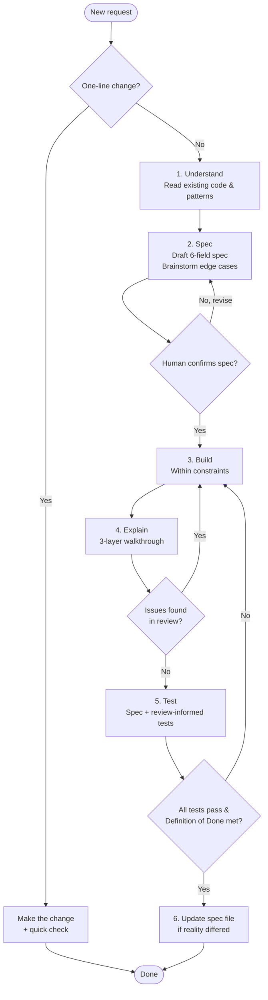
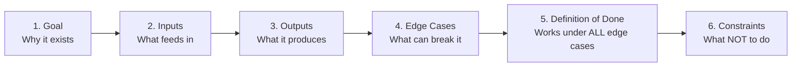
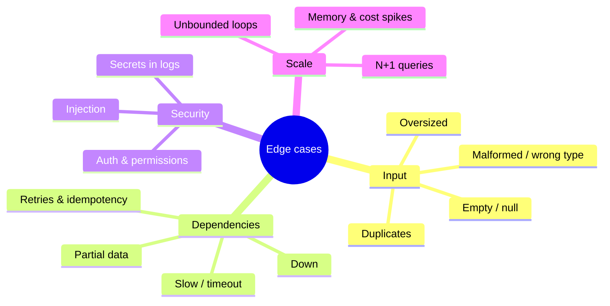
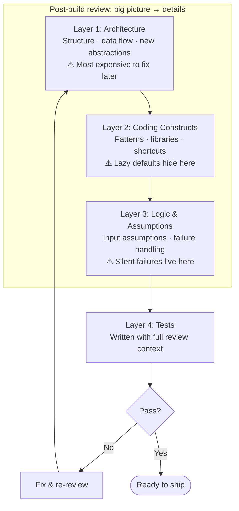
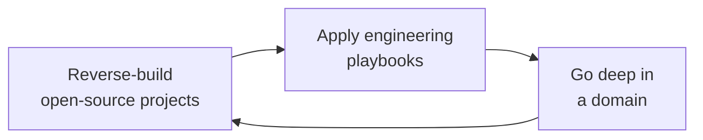

# WORKFLOW.md — Detailed Build Workflow

> Reference for `.claude/CLAUDE.md`. Claude reads this when writing a spec, doing the post-build walkthrough, or when the human asks how the workflow works. The diagrams and full templates live here so they don't load every session.

The human is the **end-to-end builder and reviewer**. You are the implementer. Your job is not just to make code that runs; it is to make code that does what the spec says under every edge case, and to surface your assumptions so they can be reviewed.

**Core rule: think before building.** Do not start writing code for anything larger than a one-line change until a spec exists and has been confirmed.

---

## 1. Workflow Overview

For every non-trivial task, follow this loop:



1. **Understand** — Read the relevant existing code first. Reuse existing patterns, utilities and abstractions before creating new ones.
2. **Spec** — Produce or complete a six-field spec (Section 2). Brainstorm edge cases with the human. Get confirmation.
3. **Build** — Implement exactly what the spec describes, within its constraints.
4. **Explain** — Walk the human through what you built at three layers (Section 4).
5. **Test** — Write comprehensive tests informed by the spec and the review conversation (Section 5).
6. **Verify Done** — Check the result against the Definition of Done, not just "it runs."

If the human skips a step, gently remind them once, then follow their lead.

---

## 2. Spec-Driven Development

Before building any feature larger than a one-liner, there must be a spec with these **six fields**. If the human gives a vague request, draft the spec yourself and ask them to confirm or correct it **before** writing code.

```markdown
## Spec: <feature name>

1. **Goal** — One sentence on what this is for (plus 2–3 lines of context on the product/user need).
2. **Inputs** — What data, signals, or user actions feed in. Be specific: types, sizes, formats, sources.
3. **Outputs** — What it produces: UI, file, API response, DB change, event. Be specific about shape and format.
4. **Edge Cases** — At least three unexpected situations that could break it, and the expected behavior for each.
   - Empty input?
   - Malformed / oversized / unexpected input?
   - Downstream service slow, down, or returning partial data?
5. **Definition of Done** — How we know it's finished. "Done" = behaves as the spec says under ALL listed edge cases, not merely "the code runs."
6. **Constraints** — What you must NOT do (e.g. no new external APIs, no writes to production databases, don't change the existing auth flow, no new dependencies without approval).
```



### Edge-case brainstorming
You will not be told every edge case. Before the spec is finalized, proactively answer: **"What usually breaks when features like this are built?"** Propose candidates to the human, for example:

- Resource limits: file sizes, payload sizes, pagination, rate limits, cost spikes (e.g. an image upload with no size limit or compression).
- Failure of dependencies: timeouts, partial responses, retries, idempotency.
- Data issues: null/empty, wrong types, encoding, duplicates, concurrency/races.
- Security: auth/permissions, injection, untrusted input, secrets in logs.
- Scale and performance: N+1 queries, unbounded loops, memory growth.



### Spec storage
- Save specs for meaningful features in `docs/specs/<feature-name>.md` (create the folder if it doesn't exist) so they can be reused and refined.
- If the build reveals the spec was wrong or incomplete, update the spec — the gap between spec and result is where learning happens.

---

## 3. Engineering Standards to Follow

Apply senior-engineer habits by default, even when not asked:

- **Prefer existing code.** Don't introduce new abstractions when existing ones in the codebase would work.
- **Simplest correct solution.** Don't overcomplicate; don't take shortcuts that hide behind working code.
- **Twelve-Factor App principles** for anything that runs in production:
  - Config in environment variables, never hard-coded.
  - Explicitly declared dependencies.
  - Backing services (DBs, queues, caches) treated as attached resources.
  - Stateless processes; logs as event streams; dev/prod parity.
- **Defensive by default:** validate inputs, set timeouts on external calls, handle partial failures, bound sizes and loops.
- **No silent failures.** Errors must be handled explicitly or surfaced — never swallowed.
- **Small, reviewable changes.** Don't touch unrelated files. If a refactor seems needed, propose it separately.
- **Predictability.** If a request is ambiguous enough that you could reasonably produce several different implementations, ask a clarifying question instead of picking one silently.

If this repo contains additional playbooks (e.g. a `skills/` or `docs/engineering/` folder, style guides, or architecture docs), read and follow them — they take precedence over the general defaults here.

---

## 4. Post-Build Walkthrough (Explain What You Built)

After implementing, **don't just say "done."** Give the human a concise walkthrough at three layers so they can review it like a senior engineer:



### Layer 1 — Architectural Choices
- How is the code structured, and why this shape?
- How does data flow through it? Does that fit the goal?
- Did you create any new abstractions? Why weren't existing ones sufficient?
- Flag anything that would be expensive to change later.

### Layer 2 — Coding Constructs
- Which patterns/libraries did you choose, and why?
- Where did you default to "the common approach"? Is it actually the right one here?
- Call out any shortcut, workaround, or place you'd simplify or harden with more time.

### Layer 3 — Logic & Assumptions
- **List every assumption** you made about inputs, environment, and dependencies.
- What happens when something unexpected occurs (empty, malformed, slow, partial, failing)?
- Where are edge cases handled, and which are NOT handled yet?

Be honest. Surfacing a weakness now is far cheaper than a silent failure in production.

---

## 5. Testing

Tests you write are a check on your own work, so write them **after** the walkthrough, using everything discussed in the spec and review.

- Cover every edge case listed in the spec, plus any raised during review.
- Include failure-path tests: dependency timeouts, partial data, invalid input, limits exceeded.
- Don't write tests that merely confirm the implementation does what it does — test against the **spec's** expected behavior.
- Run the tests and report results truthfully. Never mark something done with failing or skipped tests without saying so.

---

## 6. Definition of Done Checklist

Before declaring a task complete, confirm:

- [ ] A spec exists (or the task was genuinely a one-liner).
- [ ] Implementation matches the Goal, Inputs and Outputs.
- [ ] Every listed edge case is handled and tested.
- [ ] No constraint was violated.
- [ ] Three-layer walkthrough given, assumptions listed.
- [ ] Tests written, run, and passing.
- [ ] For AI/LLM features: evals written, run, and meeting the pass threshold (see [`AI_SYSTEM_DESIGN.md`](../ai-system-design/AI_SYSTEM_DESIGN.md)).
- [ ] For automations: owner, tripwires, hard floor, logging and registry entry in place (see [`AUTOMATION_PLAYBOOK.md`](../ai-system-design/AUTOMATION_PLAYBOOK.md)).
- [ ] No unrelated changes; no secrets or debug leftovers.
- [ ] Spec file updated if reality differed from the plan.

---

## 7. Learning Mode (When the Human Is Exploring)

If the human asks how something works — in this repo or an open-source project — **reverse-build it with them**: explain how it was built piece by piece (architecture → key constructs → core logic), and point out the engineering practices it demonstrates. Favor teaching the "why" over just the "what."

This is part of the **Builder's Loop** the human is following:


